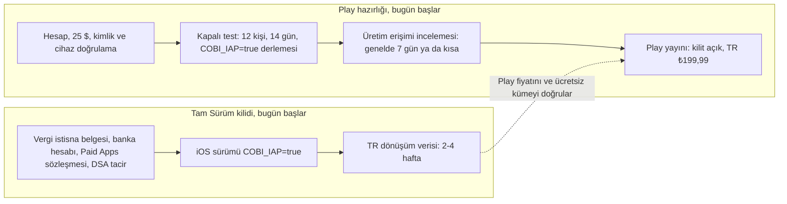

# Türkiye pazarı ve Google Play: Cobi Paint için araştırma

8 Kasım 2026 · Araştırma ajanının raporu. Yalnız herkese açık sayfalar okundu; hiçbir hesaba girilmedi, kimseyle iletişim kurulmadı. Komisyon, vergi, 20/B istisnası ve 10 ülke açılışı 3 Kasım raporlarında [42]; burada tekrarlanmadı. Bu raporda "Play" Google Play demektir, "Tam Sürüm kilidi" planlanan tek seferlik ücretli kilittir (`com.cobi.paint.full`, TR ₺199,99, ABD 5,99 $).

## 0. Sonuç

**Karar: Tam Sürüm kilidini önce iOS'ta aç. Play'i hemen ardından, kilit ilk günden açık olarak yayımla. Play hesabını ve kapalı testi bugün başlat, çünkü Play'in en az üç haftalık sabit hazırlık süresi var.**

Gerekçe:

1. **Türkiye'de erişim Android'de.** Ekim 2026'da mobil web trafiğinin %76,9'u Android, %23,1'i iOS [1]. 2025 ortalaması %75,2 / %24,4. Beş TRT çocuk uygulamasının üçünde Play puan sayısı App Store Türkiye puan sayısının 9–16 katı [18][20].
2. **Ama Android'de kurulum başına gelir düşük.** Küresel medyan: kurulumdan 35 gün içinde ödemeye geçiş iOS'ta %2,6, Play'de %0,9; 60. gün kurulum başına gelir 0,42 $ ve 0,16 $ [7] (ikincil kaynak, abonelikli uygulamalar). Türkiye'de harcamanın iki mağazaya bölünüşünü 2025–2026 için bulamadım.
3. **Play'i kilitsiz açıp sonra kilitlemek, Android kullanıcısından sayfa geri almak demek.** Kod kilit açıkken ücretsiz olmayan sayfaları gizliyor (`lib/providers/app_provider.dart:106–107`) [41]. Play Families politikası, sonradan uygulama içi satın alma eklenirse mevcut kullanıcıya bildirmeyi istiyor [29]. Android'de "bu kullanıcı ücretsiz dönemde kurdu" bilgisini güvenilir veren bir mağaza sinyali yok.
4. **Play'in hazırlık süresi kısaltılamaz.** 13 Kasım 2023'ten sonra açılan kişisel hesap, üretime çıkmadan önce en az 12 test kullanıcısıyla 14 gün kesintisiz kapalı test yapar; üretim erişimi incelemesi genelde 7 gün ya da daha kısa sürer [31]. Kimlik ve gerçek Android cihaz doğrulaması da şart [32][33].
5. **Play Türkiye'de fiyat beklentisi düşük.** "çocuk boyama" aramasının ilk 30 sonucundaki 26 çocuk uygulamasından 5'i tamamen ücretsiz ve reklamsız; ikisi RV AppStudios'un 50 ve 100 milyon+ kurulumlu uygulamaları [18]. TRT Çocuk uygulamaları ücretsiz ve reklamsız [18]. Tek fiyatlı satın alma sunan 6 rakip ₺25,99–₺549,99 istiyor; ₺199,99 bu aralığın ortasında kalıyor.

Kaba hesap (benim tahminim, Türkiye'ye özgü değil): 1.000 iOS kurulumu %2,6 ile 26 satış × ≈₺135 net = ≈₺3.510 getirir [7][42]. Play, iOS'un 3,3 katı kurulum getirir ve %0,9 dönüşürse 3.300 × %0,9 ≈ 30 satış × ≈₺142 = ≈₺4.200 eder. Yani Play, Türkiye gelirini kabaca iki katına çıkarabilir; ama yalnız Tam Sürüm kilidi açıksa.

| Gösterge | Değer | Kaynak |
|---|---|---|
| Mobil web trafiği, Ekim 2026 | Android %76,9 · iOS %23,1 | [1] |
| Tablet web trafiği, Ekim 2026 | Android %74,9 · iOS %25,1 | [2] |
| Apple TR otomatik fiyatı, 5,99 $ karşılığı | ₺299,99 (3,99 $ karşılığı ₺199,99) | [15] |
| Dolar/TL, 3 Kasım 2026 | ≈50,0 | [16] |
| Yıllık TÜFE, Ekim 2026 | %29,77 | [28] |
| Çocuk nüfusu (0–17), 31 Aralık 2025 | 21.375.930 | [21] |
| 3–5 yaş çocuk, Kasım 2026 | ≈3,1 milyon (doğum kohortlarından benim tahminim) | [22] |
| Play TR "çocuk boyama" ilk 30'daki çocuk uygulamaları | 26 uygulama: 11'inde reklam, 21'inde satın alma, 5'i tamamen ücretsiz, 23'ünde öğretmen onayı rozeti | [18] |

## 1. iOS ve Android payı

### 1.1 StatCounter

StatCounter web sayfası gösterimlerini sayar; cihaz tabanını değil [1]. Yine de iki mağazanın Türkiye'deki göreli büyüklüğü için en güncel açık veri bu.

| Dönem | Android (mobil) | iOS (mobil) | Android (tablet) | iOS (tablet) |
|---|---|---|---|---|
| 2024 ortalaması | %78,6 | %20,9 | — | — |
| 2025 ortalaması | %75,2 | %24,4 | %74,7 | %25,2 |
| Ocak–Ekim 2026 ortalaması | %75,3 | %24,6 | %69,7 | %30,2 |
| Ekim 2026 | %76,9 | %23,1 | %74,9 | %25,1 |

- Mobil iOS payı 2025'te aylık %20,2 ile %30,1 arasında oynadı (en yüksek Ocak 2025); 2026'da %23,0–%26,2 aralığında kaldı. Tablet iOS payı Haziran 2026'da %41,2'ye çıktı, Ekim'de %25,1'e döndü [1][2].
- Tablet trafiği Türkiye'deki toplam web trafiğinin yalnız %0,64'ü; mobil %78,6, masaüstü %20,8 (Ekim 2026) [3]. Okul öncesi çocuk büyük olasılıkla ebeveynin telefonunu kullanıyor (bölüm 4.2).

### 1.2 Çocuk uygulamalarında kitle: TRT örneği

TRT uygulamaları Türkçe ve Türkiye'ye yönelik. Bu yüzden Play'deki (küresel) puan sayısı büyük ölçüde Türkiye'yi gösterir. App Store sayısı yalnız Türkiye vitrinidir [18][20]. İki mağazanın puan isteme davranışı farklı; oran kaba bir vekildir.

| Uygulama | Play kurulum bandı | Play puan sayısı | App Store TR puan sayısı | Oran |
|---|---|---|---|---|
| TRT Çocuk | 5 milyon+ | 17.602 | 1.079 | 16,3 |
| TRT Piksel Boyama | 1 milyon+ | 2.993 | 213 | 14,1 |
| TRT Çocuk Anaokulum | 5 milyon+ | 7.058 | 815 | 8,7 |
| TRT Rafadan Tayfa Tornet | 1 milyon+ | 18.907 | 247 | 76,5 |
| TRT Çocuk Oyun Dünyası | 1 milyon+ | 8.808 | 15.993 | 0,55 |

### 1.3 Harcama: App Store ve Play

**Türkiye için 2025–2026 mağaza bazında harcama bölünüşünü bulamadım (DOĞRULANAMADI).** Bulduğum en yakın veriler:

- AppMagic ve Gamigion: Türkiye'de yerli mobil oyun geliri 2025'te 347 milyon $ (yıllık +%6), indirme 1,8 milyar (−%4). Mağaza ayrımı yok [4].
- Adjust Türkiye 2025 raporu: Türkiye 2024'te 3,66 milyar indirmeyle dünyada 8.; uygulama ekonomisi gelirinin 2029'da 1,65 milyar $'a çıkması bekleniyor. Mağaza ayrımı yok [5].
- Sensor Tower (Milliyet, Nisan 2021): Türkiye'de mobil uygulamalara toplam 553 milyon $ harcandı; muhtemelen 2020 verisi, mağaza ayrımı yok [6].
- Küresel platform farkı, RevenueCat 2026 (The Social Outline özeti; RevenueCat sayfasının görünen metninde bu grafikleri bulamadım): 35 günde ödemeye geçiş iOS %2,6 / Play %0,9; 60. gün kurulum başına gelir 0,42 $ / 0,16 $; ödeyen başına ilk yıl geliri 23,38 $ / 21,62 $ [7]. Fark ödeyen başına harcamada değil, ödemeye geçen kullanıcı oranında.
- RevenueCat'in kendi sayfası: Play'deki abonelik iptallerinin yaklaşık üçte biri istem dışı ödeme hatası; App Store'da bu oran %14 [7]. Bu abonelik verisi; tek seferlik satın almada ödeme sürtünmesinin yönünü gösterir.

## 2. Türkiye'de nasıl ödeniyor

### 2.1 Ödeme yöntemleri

| Yöntem | Play, Türkiye [8] | App Store, Türkiye [9] |
|---|---|---|
| Kart | Visa, Mastercard, American Express, TROY. TROY 15 Nisan 2025'ten beri geçerli [10]. | "Çoğu kredi ve banka kartı". TROY kabulünü doğrulayamadım; kullanıcı şikâyetleri kabul edilmediğini söylüyor (DOĞRULANAMADI). |
| Operatör faturasıyla ödeme | Türk Telekom, Turkcell, Vodafone. Yalnız Play Store uygulamasından; rootlu cihazda yok; ön ödemeli hat desteklenmeyebilir. | Paycell (Turkcell), Türk Telekom Mobil Ödeme, Vodafone Mobil Ödeme. |
| Bakiye ve hediye | Play bakiyesi ve hediye kodları; Turkcell Pasaj 25, 50 ve 100 TL'lik kod satıyor [11]. Sayfada nakitle bakiye yükleme de geçiyor; Türkiye'de hangi noktalarda olduğu DOĞRULANAMADI. | Apple Hesabı bakiyesi: App Store ve iTunes Hediye Kartı ya da para ekleme. |
| Apple Pay, PayPal | — | Türkiye satırında yok. |
| Kabul edilmeyen | Havale, Western Union, MoneyGram, sanal kredi kartı (VCC) hizmetleri. Banka sanal kartlarının bu kapsama girip girmediği DOĞRULANAMADI. | — |
| Aile içi paylaşım | Family Library uygulama içi satın almayı paylaşmaz [40]. Family Link ile ebeveyn onayı. | Aile Paylaşımı tek seferlik satın almayı paylaşır; Ask to Buy ile ebeveyn onayı. |

### 2.2 Küçük tek seferlik satın almayı kolaylaştıran ve zorlaştıranlar

Kolaylaştıranlar:

- İki mağaza da fiyatı TL ve KDV dâhil gösteriyor; ebeveyn kur hesabı yapmıyor [8][9].
- Üç operatörün faturası iki mağazada da kullanılabiliyor. Bu yol, internete kapalı kart engelini aşıyor.
- TROY yalnız Play'de doğrulanmış durumda; TROY'u tek kartı olan ebeveyn için Play bir avantaj [10].

Zorlaştıranlar:

- BDDK kararıyla (31 Aralık 2017'den beri) kartlar internet alışverişine kapalı geliyor; sahibi bankacılık uygulamasından açıyor [12]. İlk mağaza alışverişinde bu bir adım daha demek.
- Operatör faturasıyla ödemede aylık ve işlem başı limitler var; ₺199,99 bu limitlerin çok altında. Güncel kesin tutarı doğrulayamadım (Dünya haberi 2.500 TL işlem başı, 6.500 TL aylık diyor; sayfayı açamadım) [13].
- Bankaların mağaza ödemelerinden yurt dışı işlem ücreti alıp almadığı DOĞRULANAMADI.
- Play'de satın alma Google hesabına bağlı; çocuğun ayrı Google hesabı olan tablette Tam Sürüm yeniden satın alınmalı [40]. iOS'ta Aile Paylaşımı bu sorunu çözüyor.

## 3. Fiyat seviyeleri

### 3.1 Apple Türkiye fiyat noktaları (8 Kasım 2026)

Apple'ın fiyat tablosu herkese açık değil. Aşağıdaki karşılıkları ABD ve Türkiye vitrinlerinde aynı ücretli uygulamaların fiyatından okudum [15].

| ABD fiyatı | Türkiye fiyatı | Örnek uygulamalar |
|---|---|---|
| 0,99 $ | ₺49,99 | Plague Inc. |
| 1,99 $ | ₺99,99 | Pou |
| 2,99 $ | ₺149,99 | Shadowrocket |
| 3,99 $ | ₺199,99 | Geometry Dash, LIMBO |
| 4,99 $ | ₺249,99 | Stardew Valley, Terraria |
| 5,99 $ | ₺299,99 | Procreate Pocket, RollerCoaster Tycoon Classic |
| 6,99 $ | ₺399,99 | Bloons TD 6, Threema, GTA San Andreas |
| 9,99 $ | ₺499,99 | Things 3 |

- Minecraft 6,99 $ iken Türkiye'de ₺114,99. Geliştirici Türkiye fiyatını elle yönetince Apple'ın otomatik fiyatı devre dışı kalıyor [15].
- Planlanan ₺199,99, Apple'ın 3,99 $ için verdiği otomatik fiyatla aynı. 5,99 $ tabanla otomatik eşitleme ₺299,99 verirdi.
- ₺299,99 KDV hariç ₺250 eder; 50 TL/$ kurla 5,00 $, ABD fiyatının %83'ü. ₺199,99 aynı hesapla 3,33 $, ABD fiyatının %56'sı (benim hesabım) [15][16].

### 3.2 Apple'ın Türkiye değişiklikleri

"Eşitleme" (equalization): Apple'ın taban vitrindeki fiyattan diğer vitrinlerin fiyatını kur ve vergiyle otomatik türetmesi.

| Tarih | Ne oldu | Kaynak |
|---|---|---|
| 2 Aralık 2024 | Japonya ve Türkiye fiyat güncellemesi (otomatik eşitlenen vitrinlerde) | [14] |
| 17 Kasım 2025 | Polonya, İsviçre ve Türkiye fiyat güncellemesi | [14] |
| 29 Ocak 2026 | Türkiye dijital hizmet vergisi %7,5 → %5; fiyat değişmedi, geliştirici hasılatı arttı | [14] |
| 27 Ağustos 2026 | İsrail, Endonezya, Fas, Kongo fiyat güncellemesi; Türkiye yok | [14] |

- Apple'ın geliştirici haber akışında 8 Kasım 2026'ya kadar 2026 için Türkiye fiyat güncellemesi yok [14].
- Bu güncellemeler otomatik yenilenen abonelikleri ve fiyatı elle yönetilen vitrinleri değiştirmiyor [14]. ₺199,99 elle girilirse Apple onu hiç güncellemez. Yıllık enflasyon %29,77 (Ekim 2026) [28]; elle fiyat altı ayda bir gözden geçirilmeli.

### 3.3 Play'de TL fiyat

- Play, girilen taban fiyatı o günün kuruyla TL'ye çevirir, bazı ülkelerde vergiyi ekler ve yerel fiyat kalıbına yuvarlar. Kur değişince fiyatı kendisi güncellemez; geliştirici "Update exchange rates" ile elle yeniler [17].
- 5,99 $ taban, 50 TL/$ kur ve %20 KDV ile ≈₺359 eder (benim hesabım; Google'ın yuvarlama kalıbını doğrulayamadım). Bu yüzden Play'de de Türkiye fiyatı elle ₺199,99 girilmeli.
- Play'in ülke başına izin verdiği TL fiyat aralığı tablosu JavaScript ile yükleniyor; okuyamadım (DOĞRULANAMADI). Gözlenen aralık: BabyBus sayfasında ₺0,59'luk ürün, Lumornis sayfasında ₺8.339,99'luk ürün var [18].
- Aynı ürünün TL/$ oranı Play'de 9 ile 59 arasında değişiyor (örnek: Sunny Kid ₺25,99 / 2,99 $; Budge ₺549,99 / 9,99 $; Bimi Boo ₺709,99 / 11,99 $) [18]. 50 TL/$ kur ve %20 KDV ile eşdeğer oran ≈60'tır. Geliştiricilerin bir kısmı Türkiye'de derin indirim yapıyor, bir kısmı eşdeğer fiyat istiyor.

### 3.4 Play Türkiye: "çocuk boyama" ilk 30 sonuçtaki çocuk uygulamaları

Yöntem: 8 Kasım 2026'da `hl=tr&gl=TR` ile arama ve uygulama sayfalarını indirdim, sayfaya gömülü veriyi okudum [18]. Kurulum bandı ve puan sayısı küresel; puan Türkiye'ye özgü (aynı uygulama ABD vitrininde farklı puan, aynı puan sayısı gösteriyor). Fiyat aralığı Play'in "Öğe başına" alanı; abonelikleri de kapsar. "Onay": öğretmen onayı rozeti (bölüm 5.2). Yetişkinlere yönelik 4 sonuç (sıra 8, 18, 21, 24) tabloda yok.

| Sıra | Uygulama (geliştirici) | Kurulum | Puan (TR) | Puan sayısı | Uygulama içi fiyat (TR) | Reklam | Yaş etiketi | Onay |
|---|---|---|---|---|---|---|---|---|
| 1 | Boyama ve öğren (Orange Studios Games) | 100 milyon+ | 3,9 | 292.215 | ₺144,99 | var | 8 yaşa kadar | var |
| 2 | Çocuklar için Boyama Oyunları (IDZ Digital) | 10 milyon+ | 4,6 | 31.304 | ₺13,99–₺284,99 | var | 12 yaşa kadar | var |
| 3 | Coloring Games: Color & Paint (RV AppStudios) | 100 milyon+ | 4,3 | 124.283 | yok | yok | 12 yaşa kadar | var |
| 4 | Coloring games for kids: 2-5 y (Bebi Family) | 5 milyon+ | 4,0 | 34.843 | ₺6,99–₺2.099,99 | yok | 5 yaşa kadar | var |
| 5 | Little Panda's Kids Coloring (BabyBus) | 10 milyon+ | 3,5 | 5.394 | ₺0,59–₺34,99 | var | 12 yaşa kadar | yok |
| 6 | Easy coloring book for kids (Kakadoo) | 5 milyon+ | 3,7 | 8.233 | ₺31,99–₺96,99 | yok | 8 yaşa kadar | var |
| 7 | Çocuk çizim - boyama oyunları (Mini Pixel) | 100 bin+ | 3,6 | 229 | ₺56,99–₺184,99 | yok | 12 yaşa kadar | var |
| 9 | Çocuklar için Boyama Oyunları (Budge Studios) | 500 bin+ | 4,1 | 4.261 | ₺549,99 | var | 5 yaşa kadar | var |
| 10 | Çocuk çizim ve boyama oyunları (Bini Games) | 10 milyon+ | 3,7 | 16.616 | ₺14,99–₺399,99 | var | 8 yaşa kadar | var |
| 11 | Çocuk Resim Boyama Oyunları 2+ (Game Tunes) | 50 bin+ | — | — | ₺42,99 | yok | 5 yaşa kadar | var |
| 12 | Coloring & Drawing for Kids (Play and Learn Games) | 10 bin+ | 4,2 | 30 | yok | yok | 8 yaşa kadar | var |
| 13 | Coloring Book - Kids Paint (Sunny Kid Games) | 10 milyon+ | 3,5 | 13.025 | ₺25,99 | var | 8 yaşa kadar | var |
| 14 | Prensesler - Boyama Kitabı (Orange Studios Games) | 50 milyon+ | 3,9 | 45.936 | ₺144,99 | var | 8 yaşa kadar | var |
| 15 | Bebek çizim - boyama oyunları (Bimi Boo) | 1 milyon+ | 4,4 | 25.485 | ₺304,99–₺2.049,99 (aylık ve yıllık abonelik) | yok | 5 yaşa kadar | var |
| 16 | Çocuk Boyama Oyunlar & Kitabı (IDZ Digital) | 10 milyon+ | 4,0 | 5.704 | ₺209,99–₺234,99 | var | 8 yaşa kadar | var |
| 17 | Çocuklar Boyama Kitabı (Toy Tap) | 10 milyon+ | 4,3 | 14.020 | ₺13,99–₺119,99 | var | 12 yaşa kadar | yok |
| 19 | Disney Coloring World (StoryToys) | 10 milyon+ | 4,2 | 59.997 | ₺0,90–₺1.999,99 | yok | 6-8 yaş | var |
| 20 | Super Kids Coloring Book (Fat Tuna) | 50 bin+ | — | — | yok | yok | 8 yaşa kadar | var |
| 22 | Çocuk boyama ve çizim oyunlar (Bimi Boo) | 5 milyon+ | 4,2 | 19.650 | ₺99,99–₺709,99 | yok | 5 yaşa kadar | var |
| 23 | Bimi Boo Çocuklar için Boyama (Bimi Boo) | 10 milyon+ | 4,1 | 28.707 | ₺154,99–₺709,99 | yok | 8 yaşa kadar | var |
| 25 | Coloring for Kids: By Number (Play and Learn Games) | 100 bin+ | 3,7 | 204 | yok | yok | 8 yaşa kadar | var |
| 26 | Çizim Oyunları: Çizim ve Renk (RV AppStudios) | 50 milyon+ | 4,0 | 27.903 | yok | yok | 12 yaşa kadar | yok |
| 27 | 1+ yaş için boyama oyunu (Mini Muffin) | 500 bin+ | 3,6 | 1.470 | ₺104,99 | yok | 5 yaşa kadar | var |
| 28 | My Little Pony Color By Magic (Budge Studios) | 10 milyon+ | 4,4 | 55.090 | ₺21,99–₺549,99 | var | 6-12 yaş | var |
| 29 | Boyama eğitici çocuk oyunları (GoKids!) | 1 milyon+ | 4,0 | 1.245 | ₺5,49–₺41,99 | var | 8 yaşa kadar | var |
| 30 | Coloring games for kids age 2 (Amaya Kids) | 1 milyon+ | 4,0 | 1.528 | ₺12,99–₺579,99 | yok | 5 yaşa kadar | var |

Bu 26 uygulamanın özeti:

- 11'inde reklam var; reklamlı 11 uygulamanın hepsi satın alma da sunuyor (büyük olasılıkla "reklamları kaldır").
- 21'inde satın alma var. En düşük ürün fiyatının medyanı ₺31,99, en yüksek ürün fiyatının medyanı ₺234,99.
- Tek fiyatlı 6 uygulama: ₺25,99, ₺42,99, ₺104,99, ₺144,99 (iki uygulama), ₺549,99.
- 5'i tamamen ücretsiz ve reklamsız. RV AppStudios açıklamasında reklam, satın alma ve ödeme duvarı olmadığını yazıyor.
- 13'ü 10 milyon+ kurulumlu; bunların 9'unda reklam var.
- 23'ü öğretmen onayı rozeti taşıyor; 7'si "5 yaşa kadar" etiketli.
- Yabancı geliştiricilerin çoğu Türkçe başlık kullanıyor ("Çocuklar için Boyama Oyunları", "Bebek çizim - boyama oyunları").

Aynı ürünlerin ABD fiyatı [18]: Orange 3,49 $ / ₺144,99; Budge 9,99 $ / ₺549,99; Mini Muffin 2,99 $ / ₺104,99; Bimi Boo 2,99–11,99 $ / ₺99,99–₺709,99; Bebi Family 1,99–49,99 $ / ₺6,99–₺2.099,99.

## 4. Küçük çocuklu aileler

### 4.1 Nüfus (TÜİK)

| Gösterge | Değer | Kaynak |
|---|---|---|
| Çocuk nüfusu (0–17), 31 Aralık 2025 | 21.375.930; nüfusun %24,8'i | [21] |
| 0–4 yaşın çocuk nüfusundaki payı | %22,7 (2020'de %26,9) → ≈4,85 milyon (benim hesabım; başka TÜİK veri setleri 4,77–4,95 milyon veriyor) | [21] |
| Canlı doğum | 2020: 1.112.859 · 2021: 1.079.842 · 2022: 1.035.795 · 2023: 958.408 · 2024: 937.559 · 2025: 895.374 | [21][22] |
| Toplam doğurganlık hızı, 2025 | 1,42 | [22] |
| 3–5 yaş, Kasım 2026 | ≈3,1 milyon (Kasım 2020–Kasım 2023 doğumlarından; ölüm ve göç düşülmedi; benim tahminim) | [22] |
| 0–17 yaş çocuğu olan hane | 26.977.795 hanenin %41,9'u ≈ 11,3 milyon hane (sayı benim hesabım) | [21] |
| 5 yaş okul öncesi net okullaşma, 2024/25 | %82,5 | [21] |

Doğum sayısı 2020'den 2025'e %19,5 azaldı. Hedef kitle her yıl küçülüyor.

### 4.2 Çocukların cihaz kullanımı

- TÜİK'in 2024 araştırması yalnız 6–15 yaşı kapsıyor [23]: internet kullanımı %91,3 (2021: %82,7); akıllı telefon kullanımı %76,1 (6–10 yaş %66,3); kendine ait akıllı telefon %43,9; dijital oyun %74,0 (6–10 yaşta erkek %80,6, kız %70,6); hafta içi günde 2 saat ve üstü internet 6–10 yaşta %30,6.
- 0–6 yaş için ulusal temsilî bir araştırma bulamadım (DOĞRULANAMADI).
- Polat (2025): 5–6 yaş çocuğu olan 407 ebeveyn, kolayda örneklem, çevrim içi anket, ailelerin %68,6'sı düşük gelirli [24]. En sık kullanılan cihaz televizyon %50,1, akıllı telefon %40,3, tablet %8,6. Ebeveynlerin %72'si günde 1 saatten fazla ekrana izin veriyor. %29'u çocuğa hiç cihaz almamış.
- Kaspersky (Nisan 2026, Safe Kids kullanıcılarının Ocak–Şubat verisi): YouTube Türkiye'de çocukların uygulama süresinin üçte birinden fazlası [26]. Örneklem Safe Kids kullanan ailelerle sınırlı.

### 4.3 Ebeveyn tutumu ve ödeme isteği

- Göle, Özberk ve Kaya (Nisan 2026), 4–8 yaş çocuğu olan ebeveynler; örneklem büyüklüğü özette yok [25]. Ebeveynler uygulamada eğiticiliği önemsediklerini söylüyor, ama ekonomik nedenle reklamlı ücretsiz uygulamayı seçiyor. Çocuklara şiddet içeren ve korkutucu reklamlar çıkıyor; ebeveynin güvenlik kaygısı yüksek. Cihaz hafta sonu ödül ve "dijital bakıcı" olarak kullanılıyor.
- Türkiye'de ücretli çocuk uygulamasına ödeme isteğini ölçen temsilî bir araştırma bulamadım (DOĞRULANAMADI).
- Ölçek için: 2026 net asgari ücret ₺28.075,50 [27]. ₺199,99 bunun %0,71'i.

Sonuç: "reklamsız" Türk ebeveyninin gerçek bir kaygısına karşılık geliyor; ama aynı ebeveyn ücretsiz seçeneğe yöneliyor. Ücretsiz küme, kilitsiz denemenin asıl aracı.

### 4.4 Yerli ve ücretsiz seçenekler

| Uygulama | Play kurulum | Puan (TR) | Satın alma | Reklam | Yaş etiketi | Onay |
|---|---|---|---|---|---|---|
| TRT Çocuk | 5 milyon+ | 3,7 | yok | yok | 12 yaşa kadar | var |
| TRT Çocuk Anaokulum | 5 milyon+ | 4,0 | yok | yok | 8 yaşa kadar | var |
| TRT Kuzucuk | 1 milyon+ | 3,8 | yok | yok | 5 yaşa kadar | var |
| TRT Piksel Boyama | 1 milyon+ | 3,8 | yok | yok | 5 yaşa kadar | var |
| TRT Çocuk Oyun Dünyası | 1 milyon+ | 4,6 | ₺72,99–₺609,99 görünüyor; açıklama "reklamsız ve ücretsiz" diyor | yok | 12 yaşa kadar | var |

- TRT uygulamaları App Store Türkiye'de de ücretsiz [20].
- TRT, Türkçe içerik, ücretsizlik ve reklamsızlığı birlikte sunuyor. Cobi'nin "reklam yok" vaadi bu kitlede tek başına ayırt edici değil. Ayrışma, üç yaşın tek başına kullanabildiği boyama motoru olmalı (pazarlama raporu [42]).
- RV AppStudios'un iki uygulaması (100 milyon+ ve 50 milyon+) tamamen ücretsiz ve reklamsız; "çocuk boyama" aramasında 3. sırada [18].

## 5. Play gereksinimleri

### 5.1 Kontrol listesi

Durum: "hazır" (repoda karşılığı var), "yapılacak", "karar".

| # | Gereksinim | Ayrıntı | Cobi durumu |
|---|---|---|---|
| 1 | Geliştirici hesabı | Kişisel hesap; tek seferlik 25 $ (ön ödemeli kart kabul edilmez); en az 18 yaş [33]. Türkiye'de geliştirici ve satıcı kaydı açık, ödeme para birimi TL, banka hesabı Türkiye'de olmalı [39]. | yapılacak |
| 2 | Kimlik doğrulama | Yasal ad ve adres Google ödeme profilinden; profil doğrulanmamışsa resmî kimlik belgesi. Geliştirici e-postası ve iletişim e-postası 6 haneli kodla; telefon doğrulaması kimlik ve cihaz doğrulamasından sonra [32]. | yapılacak |
| 3 | Gerçek cihaz doğrulaması | Yeni kişisel hesap, uygulama yayımlamadan önce Play Console mobil uygulamasıyla gerçek bir Android cihaza erişimini doğrular [32][33]. | yapılacak |
| 4 | Kurum hesabı (alternatif) | D-U-N-S numarası (ücretsiz) ve kurum belgesi gerekir [32]. 20/B istisnası gerçek kişi içindir [42]; kişisel hesap uygun. | karar: kişisel |
| 5 | Kapalı test | 13 Kasım 2023'ten sonra açılan kişisel hesap: en az 12 test kullanıcısı, 14 gün kesintisiz katılım. Sonra üç bölümlü üretim erişimi başvurusu (test, uygulama, hazırlık); inceleme genelde 7 gün ya da kısa [31]. Daha eski bir kişisel hesabın varsa bu şart yok. | yapılacak |
| 6 | Android geliştirici doğrulaması | Play uygulamalarının yaklaşık %99'u otomatik kaydedildi; Play Console ana sayfasından kontrol. Yaptırım 30 Eylül 2026'da Brezilya, Endonezya, Singapur, Tayland'da başladı; 2027'de küresel [38]. | yapılacak (kontrol) |
| 7 | Hedef API | Yeni uygulama ve güncellemeler 31 Ağustos 2026'dan beri Android 16 (API 36) hedefler [34]. Flutter 3.38.3 varsayılanı targetSdk 36, minSdk 24 [41]. | hazır |
| 8 | Play Billing Library | Sürüm 8, yeni uygulama ve güncellemeler için 31 Ağustos 2027'ye kadar geçerli [35]. Repo `in_app_purchase_android 0.5.0` ile billing 8.0.0 kullanıyor [41]. | hazır |
| 9 | Hedef kitle | Play Console'da yaş grupları; birden çok grup yalnız uygulama hepsine uygunsa [29]. Öneri: "5 yaş ve altı"; Büyük mod 6 yaş ve üstü olduğu için "6-8" eklenebilir. | karar |
| 10 | Families politikası | Yalnız çocuklara yönelik uygulama AAID, SIM/IMEI/MAC gibi kimlikleri göndermez, API 33+'te AD_ID izni istemez, konum izni istemez, yalnız çocuklara yönelik hizmetlere onaylı SDK kullanır; gizlilik politikası gerçek uygulamayı anlatır [29]. Repo bağımlılıklarında reklam ya da analiz SDK'sı yok; Android manifestinde izin satırı yok [41]. | hazır (derlenmiş manifesti bir kez kontrol et) |
| 11 | Satın alma kuralları | Reklam ya da satın almayı özendiren "şok edici ya da duygusal manipülasyon" yok; sanal para gerçek paradan ayrılır; "aşırı agresif ticari taktik" kaldırma sebebi. Sonradan satın alma ya da reklam eklenirse mevcut kullanıcıya bildirilir [29]. Play ebeveyn kapısı istemiyor; Cobi'nin kapısı kalabilir. | hazır |
| 12 | Veri güvenliği formu | Veri toplamayan uygulama da formu doldurur ve gizlilik politikası linki verir; kapalı test yolunda da gerekir. Yalnız cihazda işlenen veri beyan edilmez. Play faturalandırmasının işlediği ödeme verisi, uygulama bu veriye erişmiyorsa beyan edilmez [36]. Beklenen sonuç: "veri toplanmaz, paylaşılmaz" ve "Play Aile Politikası'na uyma taahhüdü var" etiketi [18]. | yapılacak |
| 13 | İçerik derecelendirmesi | IARC anketi; Türkiye'de PEGI gösteriliyor (rakiplerin hepsi PEGI 3) [18][29]. | yapılacak |
| 14 | Mağaza kaydı | Ad en çok 30 karakter ("Cobi: Çocuk Boyama Oyunları" 27); kısa açıklama 80 karakter; simge 512×512 PNG; tanıtım görseli 1024×500 zorunlu; en az 2, cihaz türü başına en çok 8 ekran görüntüsü, 320–3840 px, uzun kenar kısa kenarın en çok 2 katı; önerilere girmek için en az 4 adet 1080 px'lik görüntü (1080×1920) [37]. | yapılacak |
| 15 | Satın alma ürünü | `com.cobi.paint.full`, tek seferlik ürün; Türkiye fiyatı elle ₺199,99 (Play kurla güncellemez) [17]. Ürün oluşturmak ve test etmek için billing izinli bir derlemenin test yoluna yüklenmesi gerekiyor (üçüncü taraf rehberler; Google yardımı BILLING iznini anıyor). | yapılacak |
| 16 | Öğretmen onayı | Bölüm 5.2. | otomatik |
| 17 | AB DSA tacir beyanı | Satın alma varsa tacir sayılırsın; adres ve telefon 1 Mart 2027'den itibaren tüm pazarlarda gösterilir (gelir raporu 2.6) [42]. | karar (posta kutusu ve ayrı telefon) |

### 5.2 Öğretmen onayı (Teacher Approved) Türkiye'de anlamlı mı

Öğretmen onayı: Google'ın öğretmen ve çocuk medyası uzmanlarına puanlattığı, onaylanan uygulamaya rozet veren ve Play'in "Çocuklar" bölümüne alabildiği program [30].

- Başvuru yok. Families politikasına uyan, yayımlanmış ve bekleyen politika işlemi olmayan uygulama otomatik incelemeye girer [30].
- Desteklenen diller arasında Türkçe var (İngilizce, Fransızca, Almanca, Endonezce, Japonca, Korece, Portekizce, Rusça, İspanyolca, Türkçe, Arapça) [30].
- Desteklenmeyen kategori, dil ya da "yetersiz indirme" durumunda uygulama "incelenemez" olur. İndirme eşiği yayımlanmıyor (DOĞRULANAMADI) [30].
- Her güncellemede yeniden incelenir [30].
- Türkiye vitrininde rozet Türkçe görünüyor: "Öğretmenler tarafından şu yaş için onaylandı: 5 yaşa kadar" [18]. Türkiye'de "Çocuklar" bölümü ve yaş aralığı sayfaları var; "5 yaş ve altı" sayfasının ilk 20 uygulamasında RV AppStudios boyama uygulaması da var [19].
- Değerlendirme: "çocuk boyama" ilk 30'daki 26 çocuk uygulamasının 23'ünde rozet var [18]. Rozet Türkiye'de ayırt edici değil, ama yokluğu bir eksik. Yeni uygulamanın indirme eşiğini geçmesi zaman alabilir.

## 6. Öneri: Play, Tam Sürüm kilidinden önce mi sonra mı

**Öneri: Sonra; ama aynı hazırlık döneminde. Tam Sürüm kilidi iOS'ta açılsın; Play kilit ilk günden açık olarak yayımlansın; Play hesabı ve kapalı test bugün başlasın.**

Süre tahmini (benim tahminim): Play tarafı en az 3 hafta, gerçekçi 4–5 hafta.

Neden "önce" değil:

1. **Gelir yalnız kilitle gelir.** Play'i kilitsiz açmak Türkiye'deki en büyük kitleye ürünü bedava verir. Bölüm 0'daki kaba hesaba göre Play, kilit açıkken Türkiye gelirini yaklaşık iki katına çıkarabilir; kilit kapalıyken sıfır ekler.
2. **Geri alma riski Android'de daha pahalı.** Kilitli güncelleme, ücretsiz dönemde kuran kullanıcının sayfalarını gizler [41]. Families politikası bu değişikliğin bildirilmesini istiyor [29]. Eski kullanıcıyı korumak (grandfathering) iOS'ta uygulamanın ilk indirilen sürümünü veren App Store makbuzuyla mümkün; Android'de ilk kurulum zamanı yeniden kurulumda sıfırlanır. Play'de puan sırayı belirler; "eskiden bedavaydı" yorumları yeni uygulamaya ağır gelir.
3. **Fiyat önce iOS'ta öğrenilir.** ₺199,99 Apple'ın otomatik ₺299,99'unun üçte bir altında (bölüm 3.1). Play rakiplerinin tek fiyatlı kilitleri ₺25,99–₺549,99 (bölüm 3.4). İki–dört haftalık iOS Türkiye dönüşüm verisi, Play'de fiyatı ve ücretsiz kümenin büyüklüğünü (kategori başına 8 sayfa) ilk günden doğru koymayı sağlar.
4. **Hazırlık zaten paralel.** Kilidin ön şartları (vergi istisna belgesi, özel banka hesabı, Paid Apps, DSA tacir) haftalar sürüyor [42]. Play'in 14 günlük kapalı testi de kısaltılamıyor [31]. İkisi aynı anda yürür; Play'i bekletmek gerekmez.

Neden "çok sonra" da değil:

1. Türkiye'deki ailelerin kabaca dörtte üçü Android'de (bölüm 1). Okul öncesi çocuk çoğunlukla ebeveynin telefonunu kullanıyor (bölüm 4.2).
2. Play'de TROY ve operatör faturası, internete kapalı kartı olan ebeveyne de ödeme yolu açıyor (bölüm 2).
3. Öğretmen onayı ve "Çocuklar" bölümü indirme istiyor; Play ne kadar erken açılırsa eşik o kadar erken geçilir (bölüm 5.2).

B planı: Kilit 6–8 haftada açılamıyorsa (örneğin vergi belgesi gecikirse) Play kilitsiz açılabilir. O zaman ilk Android derlemesi, ilk açılışta cihaza bir "ücretsiz dönem kullanıcısı" işareti yazmalı (`shared_preferences`); kilitli güncelleme bu kullanıcılara Tam Sürüm'ü kendiliğinden versin. Bedeli: ilk Android kullanıcılarından hiç gelir gelmez; uygulamayı silip yeniden kuran işareti kaybeder.

iOS için not: Bugün App Store'daki sürüm her sayfayı açık veriyor. iOS'ta kilit açıldığında aynı geri alma sorunu mevcut iOS kullanıcıları için de oluşur; kitle küçük (4 Kasım'dan beri yayında, 0 puan). Uygulamanın ilk indirilen sürümüne bakıp bu kullanıcılara Tam Sürüm vermek düşünülmeli. Uygulamasını araştırmadım.

İlk 60 günde ölçülecekler: iOS Türkiye kurulumdan satışa dönüşüm (₺199,99), Play Türkiye kurulumdan satışa dönüşüm, iki mağazada iade ve "bekleyen" (ebeveyn onayı bekleyen) satın alma oranı, Play'de öğretmen onayı durumu.

## 7. Doğrulayamadıklarım

- Türkiye'de uygulama harcamasının App Store ve Play arasındaki bölünüşü (2025–2026). Açık kaynaklarda yalnız toplamlar var [4][5][6].
- RevenueCat'in platform medyanları (%2,6 / %0,9; 0,42 $ / 0,16 $): ikincil kaynaktan; RevenueCat sayfasının görünen metninde bulamadım [7].
- Play'in Türkiye için resmî TL fiyat aralığı (tablo JavaScript ile yükleniyor); Google'ın USD→TL yuvarlama kalıbı.
- TROY kartın App Store'da kabul edilip edilmediği.
- Türk bankalarının mağaza ödemelerinden yurt dışı işlem ücreti alıp almadığı.
- Güncel operatör faturasıyla ödeme limitleri (haber 2.500 TL / 6.500 TL, operatör sayfası 5.000 TL diyor; ₺199,99 için bağlayıcı değil).
- Play'de nakitle bakiye yüklemenin Türkiye'de nerede yapıldığı.
- 0–6 yaş için ulusal cihaz kullanım verisi; Türkiye'de ücretli çocuk uygulamasına ödeme isteğini ölçen araştırma.
- Öğretmen onayı için gereken indirme eşiği.
- 0–4 yaş sayısı: TÜİK veri setleri arasında 4,77–4,95 milyon farkı.

## 8. Kaynaklar

Hepsine 8 Kasım 2026'da erişildi.

1. StatCounter, Mobile Operating System Market Share Türkiye, aylık CSV Ocak 2024–Ekim 2026 — `https://gs.statcounter.com/os-market-share/mobile/turkey`
2. StatCounter, Tablet Operating System Market Share Türkiye — `https://gs.statcounter.com/os-market-share/tablet/turkey`
3. StatCounter, Desktop vs Mobile vs Tablet Market Share Türkiye — `https://gs.statcounter.com/platform-market-share/desktop-mobile-tablet/turkey`
4. WN Hub, "In 2025, domestic mobile revenue in Türkiye increased by 6% to reach $347 million" (AppMagic ve Gamigion) — `https://wnhub.io/news/finance/item-51073` · Mobidictum, AppMagic Türkiye 2026 raporu özeti (18 Haziran 2026) — `https://mobidictum.com/appmagic-turkiye-mobile-gaming-landscape-2026/`
5. Adjust, Mobile app trends spotlight edition: Türkiye 2025 (PDF) — `https://investgame.net/wp-content/uploads/2025/11/turkey-app-trends-2025.pdf`
6. Milliyet, "Türkiye dünyada ikinci oldu! Toplamda 553 milyon dolar harcandı" (8 Nisan 2021, Sensor Tower) — `https://www.milliyet.com.tr/teknoloji/turkiye-dunyada-ikinci-oldu-toplamda-553-milyon-dolar-harcandi-6476558`
7. The Social Outline, iOS vs Android subscription economics (21 Ekim 2026; RevenueCat 2026 verisi) — `https://thesocialoutline.com/blog/ios-vs-android-subscription-economics` · RevenueCat, State of Subscription Apps 2026 — `https://www.revenuecat.com/state-of-subscription-apps/`
8. Google Play Yardım, Accepted payment methods on Google Play (Türkiye) — `https://support.google.com/googleplay/answer/2651410?hl=en&co=GENIE.CountryCode%3DTR`
9. Apple Destek, Payment methods that you can use with your Apple Account (yayın 7 Ağustos 2026) — `https://support.apple.com/en-us/111741`
10. BKM basın bülteni, "TROY, global geçerliliğini artırıyor; artık Google Play'de de geçerli!" (15 Nisan 2025) — `https://bkm.com.tr/wp-content/uploads/2025/04/TROY-Google-Isbirligi-Basin-Bulteni-2025.pdf`
11. Turkcell Pasaj, Google Play 100 TL hediye dijital kodu — `https://www.turkcell.com.tr/pasaj/hobi-oyun/dijital-urunler/oyun-pinleri-uyelikler/google-play-100-tl`
12. Bloomberg HT, "Kredi kartıyla internetten alışverişe onay için son günler" (27 Aralık 2017) — `https://www.bloomberght.com/kredi-kartiyla-internetten-alisverise-onay-icin-son-gunler-2081877`
13. Dünya, "MASAK limitleri değişti: Kart ve elektronik parada yeni sınırlar" (sayfa 403 verdi; arama özetinden) — `https://www.dunya.com/ekonomi/masak-limitleri-degisti-kart-ve-elektronik-parada-yeni-sinirlar-haberi-841084`
14. Apple Developer News RSS — `https://developer.apple.com/news/rss/news.rss` · 14 Kasım 2024: `https://developer.apple.com/news/?id=onjo01rj` · 30 Ekim 2025: `https://developer.apple.com/news/?id=nomqoqfm` · 29 Ocak 2026: `https://developer.apple.com/news/?id=gvnljl3f` · 27 Ağustos 2026: `https://developer.apple.com/news/?id=artln8br`
15. iTunes Lookup API, ABD ve Türkiye vitrinleri (uygulama kimlikleri 525818839, 575154654, 932747118, 625334537, 656951157, 1406710800, 640364616, 916366645, 1113736426, 1118115766, 578665578, 763692274, 904237743, 479516143) — `https://itunes.apple.com/lookup?id=916366645&country=tr`
16. Ekonomist, "Dolar ve euro bugün ne kadar? 3 Kasım 2026" — `https://www.ekonomist.com.tr/doviz/dolar-ve-euro-bugun-ne-kadar-3-kasim-2026-guncel-doviz-kurlari-80480`
17. Play Console Yardım, fiyat belirleme ve kur yenileme — `https://support.google.com/googleplay/android-developer/answer/6334373?hl=en`
18. Google Play Türkiye arama ve uygulama sayfaları — `https://play.google.com/store/search?q=%C3%A7ocuk%20boyama&c=apps&hl=tr&gl=TR` · `https://play.google.com/store/search?q=boyama%20oyunu&c=apps&hl=tr&gl=TR` · uygulama sayfaları `https://play.google.com/store/apps/details?id=<kimlik>&hl=tr&gl=TR`, ABD karşılaştırması `&hl=en&gl=US`
19. Google Play Türkiye, Çocuklar, 5 yaş ve altı — `https://play.google.com/store/apps/category/FAMILY?age=AGE_RANGE1&hl=tr&gl=TR`
20. iTunes Search API, "TRT çocuk", Türkiye vitrini — `https://itunes.apple.com/search?term=TRT%20%C3%A7ocuk&country=tr&entity=software`
21. TÜİK, İstatistiklerle Çocuk 2025 (Alomaliye yayını, 20 Nisan 2026) — `https://www.alomaliye.com/2026/04/20/istatistiklerle-cocuk-2025/`
22. TÜİK Doğum İstatistikleri: 2025 — `https://www.iscihaber.net/gundem/2025-yili-dogum-istatistikleri-aciklandi-canli-dogan-bebek-sayisi-895-bin-374-oldu/231786` · 2023 — `https://www.alomaliye.com/2024/05/15/dogum-istatistikleri-2023/amp/` · 2022 — `https://www.alomaliye.com/2023/05/15/dogum-istatistikleri-2022/` · 2021 — `https://www.cumhuriyet.com.tr/ekonomi/tuik-acikladi-dogurganlik-hizinin-en-yuksek-oldugu-il-sanliurfa-1935155` · 2020 — `https://alomaliye.com/2021/05/18/2020-dogum-istatistikleri/amp`
23. TÜİK, Çocuklarda Bilişim Teknolojileri Kullanım Araştırması 2024 (Alomaliye yayını, 24 Ekim 2024) — `https://www.alomaliye.com/2024/10/24/cocuklarda-bilisim-teknolojileri-kullanim-arastirmasi-2024/`
24. Polat, P. (2025). 5-6 Yaş Grubu Çocuklarda Problemli Medya Kullanımı ile Ekran Süresi Arasındaki İlişkinin İncelenmesi. Çukurova Üniversitesi Eğitim Fakültesi Dergisi, 54(2), 715–738. DOI 10.14812/cuefd.1671077 — `https://dergipark.org.tr/tr/download/article-file/4750220`
25. Göle, M. O., Özberk, G., Kaya, A. (Nisan 2026). Ebeveynlerin Dijital Araç Kullanımına Yönelik Denetim Stratejileri, Güvenlik Kaygıları ve Yönetim Biçimleri. JIER, 10(23), 111–128 — `https://dergipark.org.tr/en/pub/jier/article/1881086`
26. Cumhuriyet, "Çocukların yapay zeka araçlarına duyduğu merak araştırıldı" (27 Nisan 2026, Kaspersky) — `https://www.cumhuriyet.com.tr/ekonomi/cocuklarin-yapay-zeka-araclarina-duydugu-merak-arastirildi-2499009`
27. CNN Türk, "2026 asgari ücret Resmi Gazete'de yayımlandı" — `https://www.cnnturk.com/ekonomi/2026-asgari-ucret-resmi-gazetede-yayimlandi-2377320`
28. Gazete Oksijen, "Ekimde enflasyon yıllık yüzde 29,77, aylık yüzde 2,58 oldu" (3 Kasım 2026) — `https://gazeteoksijen.com/ekonomi/ekimde-enflasyon-yillik-yuzde-29-77-aylik-yuzde-2-58-oldu-294751`
29. Play Console Yardım, Families politikası — `https://support.google.com/googleplay/android-developer/answer/9893335?hl=en`
30. Play Console Yardım, Teacher Approved — `https://support.google.com/googleplay/android-developer/answer/10075896?hl=en`
31. Play Console Yardım, yeni kişisel hesaplar için test şartları — `https://support.google.com/googleplay/android-developer/answer/14151465?hl=en`
32. Play Console Yardım, geliştirici kimlik doğrulaması — `https://support.google.com/googleplay/android-developer/answer/10841920?hl=en`
33. Play Console Yardım, Play Console'a kayıt — `https://support.google.com/googleplay/android-developer/answer/6112435?hl=en`
34. Play Console Yardım, hedef API düzeyi şartı — `https://support.google.com/googleplay/android-developer/answer/11926878?hl=en`
35. Android Developers, Play Billing Library deprecation FAQ — `https://developer.android.com/google/play/billing/deprecation-faq`
36. Play Console Yardım, Veri güvenliği bölümü — `https://support.google.com/googleplay/android-developer/answer/10787469?hl=en`
37. Play Console Yardım, mağaza kaydı görselleri — `https://support.google.com/googleplay/android-developer/answer/9866151?hl=en`
38. Android Developers Blog, Android developer verification (Haziran 2026) — `https://android-developers.googleblog.com/2026/06/android-developer-verification.html`
39. Play Console Yardım, desteklenen geliştirici ve satıcı konumları; ödeme profili — `https://support.google.com/googleplay/android-developer/answer/9306917` · `https://support.google.com/googleplay/android-developer/answer/7161426?hl=en`
40. Google Play Yardım, Family Library — `https://support.google.com/googleplay/answer/7007852`
41. Repo (salt okuma): `lib/providers/app_provider.dart:106–107`, `lib/services/purchase_service.dart`, `pubspec.yaml`, `pubspec.lock` (`in_app_purchase_android 0.5.0` → `com.android.billingclient:billing:8.0.0`), `android/app/src/main/AndroidManifest.xml`, Flutter 3.38.3 `packages/flutter_tools/gradle/src/main/kotlin/FlutterExtension.kt` (targetSdk 36, minSdk 24)
42. Önceki raporlar: `plan/gelir-ve-yayin-raporu.html` (3 Kasım 2026), `plan/pazarlama-incelemesi-2026-11-03.html`
