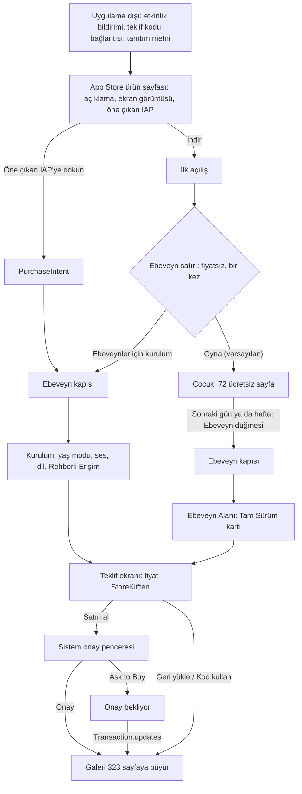

# Cobi Paint: kullanıcıyı alıcıya çevirmek

8 Kasım 2026 · Araştırma C (satın alma akışı). Salt okuma araştırması; hukuki görüş değildir.
Önceki raporda olanı tekrar etmiyorum: `plan/gelir-ve-yayin-raporu.html` (komisyon, vergi, fiyat
merdiveni, "XX-day Trial" kalıbı, RevenueCat'in genel %2,0 / %2,1 / %10,7 oranları, Sago'nun "ilk iki
gün" sözü, teklif ekranının asgari içeriği). Bu rapor yalnız yeni bulguları ve akışı verir.

Bugünkü durum (App Store, 8 Kasım 2026): 2.2.0 yayında, birincil kategori Education, 323 sayfanın
hepsi ücretsiz, IAP kapalı (`--dart-define=COBI_IAP=true` olmadan), ürün sayfasında henüz puan yok.

## Terimler

- **IAP:** uygulama içi satın alma. **Non-consumable:** bir kez alınan, bitmeyen IAP (Tam Sürüm).
- **D35 indirme→ödeme oranı:** indirmelerin 35 gün içinde en az bir ödemeye dönen payı.
- **RPI:** indirme başına gelir. **Kohort:** aynı ay indiren kullanıcı grubu.
- **Öne çıkan IAP (Promoted In-App Purchase):** App Store ürün sayfasında ve aramada görünen, satın
  alması App Store'da başlayıp uygulamada biten IAP.
- **Teklif kodu (offer code):** IAP'yi indirimli ya da ücretsiz veren, App Store Connect'te üretilen kod.
- **PPO:** ürün sayfası A/B testi. **CPP:** özel ürün sayfası.
- **Ask to Buy:** çocuk hesabının satın alması için ebeveyn onayı isteyen Apple özelliği.
- **Emsal grubu:** App Store Connect'in uygulamayı aynı kategori, iş modeli ve indirme hacmindeki
  uygulamalarla kıyasladığı grup.

## 0. Sonuç

1. **Ebeveynin teklifi bulduğu üç an var:** indirmeden önce ürün sayfası, ilk açılış ve sonraki
   ziyaretler. En güçlüsü ilk açılış: RevenueCat 2026'ya göre dönüşümlerin üçte biri kurulum günü
   oluyor [R1].
2. **Önerilen akış:** çocuk varsayılan modla hemen oynar. İlk açılışta bir kez, fiyatsız ve satın alma
   düğmesiz bir "Ebeveynler için kurulum" satırı görünür. Satır ebeveyn kapısından kuruluma, kurulumun
   son adımı teklif ekranına gider. Bu satır kurulun "çocuk ekranında teklif yok" kararına dokunur;
   kurul onayı gerekir (bölüm 9).
3. **Beklenen D35 indirme→ödeme oranı (benim tahminim, ölçüm değil):** yalnız Ebeveyn Alanı ile
   %0,5–1,5; önerilen akışla %1,5–3; güçlü ürün sayfası ve kampanyalarla %3–5. Dayanak: RevenueCat
   Education iOS medyanı %3,1 [R1], Motion Math'in çocuk uygulamasında %2,1→%4,3'ü [M1].
4. **2025–2026'da tek seferlik kilide iki yeni araç geldi:** teklif kodları 29 Ekim 2025'ten beri
   non-consumable için de var [N1]; App Store Connect Analytics 25 Mart 2026'da indirme→ödeme
   kohortlarını ve emsal kıyasını ekledi [N2]. Tanıtım, promosyon ve geri kazanım teklifleri yalnız
   abonelikte [S14].
5. **iOS'ta fiyatı kullanıcılar arasında rastgele bölen yerel araç yok** (doğruladım: PPO yalnız simge,
   ekran görüntüsü ve önizleme test eder [S11]). Temiz yol Google Play'in fiyat deneyi [GP1];
   Türkiye'de Android payı %77 (önceki rapor). iOS'ta tarihli geçici fiyat değişikliği ve kohort kıyası.
6. **Kodda akışı etkileyen üç eksik var:** açılışta sessiz hak kontrolü yok; Ekran Süresi kısıtında
   ekran "Mağazaya ulaşılamıyor" diyor; öne çıkan IAP için gereken PurchaseIntent köprüsü yok (bölüm 6.4).
7. **2.2.0'da 323 sayfanın hepsi ücretsiz.** IAP'li sürüm mevcut kullanıcılardan 251 sayfayı geri alır.
   Ürün sayfasında puan yokken bu, ilk yorumları olumsuz yapabilir. Mevcut kurulumları korumayı
   öneriyorum (bölüm 6.5).

## 1. Ölçütler

### 1.1 Dönüşüm: abonelik ve tek seferlik

| Ölçüt | Değer | Kaynak | Cobi için okuma |
|---|---|---|---|
| D35 indirme→ödeme, tüm kategoriler, medyan | iOS %2,6 · Google Play %0,9 | [R1] | iOS, Play'in ~2,9 katı dönüştürüyor; Android hasılat beklentisini düşük tut |
| D35 indirme→ödeme, Education, iOS | medyan %3,1; üst uç %12–14 | [R1] | Ödeme duvarı kullanıcıya görünür, deneme var. Cobi'nin kapalı teklifi için tavan gibi oku |
| D35 indirme→ödeme, Gaming, iOS | medyan %1,3 | [R1] | Games kategorisinde emsal daha düşük |
| D14 RPI, Education | 0,30 $ (tüm kategoriler 0,23 $) | [R1] | |
| RPI, en çok ömür boyu plan satan uygulamalar | D14 0,19 $ · D60 0,24 $ (yıllık ağırlıklı: 0,36 / 0,46 $) | [R1] | Tek seferlik model kurulum başına daha az getirir, zamanla az büyür |
| Education gelirinde tek seferlik satın alma payı | 2025 %17 (2023 %6) | Adapty SOIS 2026 [A1] | Tek ödemeye talep artıyor |
| Çocuk uygulaması, eski veri | Motion Math %2,1 → %4,3 (huni analizi ve yükseltme istemi değişikliğiyle) | MediaPost, 17 Ağustos 2012 [M1] | Ebeveyn önce kendisi oynuyor, ilk iki günde karar veriyor |

RevenueCat'te ayrı bir Kids segmenti yok; ölçütler abonelik uygulamalarından gelir. Çocuk ya da
eğitim uygulamasında tek seferlik kilit için yayımlanmış bir indirme→satın alma ölçütü bulamadım
(DOĞRULANAMADI). En iyi emsal, sahibin kendi App Store Connect hesabındaki emsal grubu (bölüm 8).

### 1.2 Kurulumdan satın almaya geçen süre

| Ölçüt | Değer | Kaynak |
|---|---|---|
| Kurulum günü (D0) dönüşüm payı, tüm uygulamalar | ~1/3 | [R1] |
| İlk hafta içindeki dönüşüm | %60+ | [R1] |
| Freemium'da 6. haftadan sonra gelen dönüşüm | %23 | [R1] |
| 2.–5. haftalar | haftada ~%1–2 | [R1] |
| Education'da D0 dönüşüm payı | %28,5 (kategoriler içinde en düşük) | [R1] |
| Education'da deneme başlatma: D0 payı / 31+ gün sonra | %71,3 / %23,5 (en yüksek geç başlama) | [A1] |

Okuma: iki tepe var. Birincisi kurulum günü; ebeveyn cihazı o an elinde tutuyor. İkincisi haftalar
sonra; Education kullanıcısı geri dönüp karar veriyor. Teklif çocuğa görünmediği için ikinci tepe ancak
ebeveyn teklifi bulabilirse oluşur.

### 1.3 İade oranları

| Kaynak | Bulgu |
|---|---|
| RevenueCat 2026 [R1] | Kategori medyanları %3–4; Kuzey Amerika %3,4, IN/SEA %7,7; freemium %2,9, sert duvar %2,5; her fiyat basamağı medyanı ~1 puan artırıyor |
| Adapty (güncelleme 10 Şubat 2026) [A2] | Education %4,86–5,1 (en yüksek kategori); freemium %3,4, sert duvar %5,8; düşük fiyatlı plan ~%2,2; Güney Kore %10'a kadar; %2–5 olağan, %10 üstü kritik |

Tek seferlik non-consumable için ayrı bir iade ölçütü bulamadım (DOĞRULANAMADI). İadeyi Apple yönetir;
geliştirici iade veremez. App Store Connect Analytics bugün "Purchase Refund Rate" ölçütünü gösteriyor
[AN5]. Cobi için beklentim %2–4: ebeveyn kapısı yanlışlıkla alımı, açık metin de beklenti farkını azaltır.

### 1.4 Ebeveynin beklentisini kuran örnekler (ABD vitrini, 8 Kasım 2026)

- **Khan Academy Kids** (132.826 puan): tamamen ücretsiz, reklamsız, aboneliksiz. Ebeveyn "iyi içerik
  ücretsiz olabilir" beklentisiyle gelir. Cobi'nin karşılığı: 72 sayfa gerçekten ücretsiz ve reklamsız.
- **LEGO DUPLO World** (201.886 puan): açıklamada "örnek içerik ücretsiz" cümlesi ve ayrı bir abonelik
  bölümü var.
- **Sago Mini World, Toca Boca Jr:** Piknik aboneliği; açıklamada "almadan önce dene" bölümü var.
- **Bimi Boo Learning Games 2+:** 3 oyun ücretsiz, tek seferlik 6,99 $. Bir yorum, yalnız 3 oyuna izin
  verip satın almaya zorladığını yazıyor. Ücretsiz kısım dar kalınca tepki geliyor.
- **Toddler Art: Coloring Games** (Ağustos 2025, 0–5 bandı): 7 gün deneme, sonra 4,99 $ tek seferlik
  "Full App Access". Açıklamada "abonelik yok" vurgusu ve ayrı bir "deneme ve fiyat" bölümü var.
- Ürün sayfasının Bilgi bölümü IAP adını, fiyatını ve "Aile Paylaşımı" etiketini kendiliğinden gösteriyor
  (Bimi Boo ve Toddler Art sayfalarında gördüm).

### 1.5 Bağımsız geliştiricinin gerçeği

Meet Anvi (3–6 yaş, analitiksiz, Indie Hackers, 6 Kasım 2026) 1.5 sürümünde isteğe bağlı bir ebeveyn
aboneliği ekledi. Abonelik tutmadı; geliştirici 5 Kasım'da kaldırdı [IH1]. Yazarın sonucu: sorun
paketleme değil, keşif. Planladığı adımlar: her bağlantıya kampanya etiketi, ürün sayfası testi, puan
isteği. Önceki rapordaki Muky aynı yönü gösteriyor.

## 2. Kurallar: izinli, yasak, kullanılamaz

Sürümler: App Review Guidelines son güncelleme 16 Ekim 2026 [G1]; HIG "Apple In-App Purchase" 17 Eylül
2026 [H1]; HIG "Onboarding" 10 Haziran 2024 [H2].

Maddelerin özü (kendi sözlerimle):

- **1.3:** Kids uygulamasında dış bağlantı, satın alma fırsatı ve çocuğu dağıtan öğe yalnız ebeveyn
  kapısının arkasındaki ayrı bir alanda olabilir. Üçüncü taraf analitik ve reklam olmamalı.
- **3.1.1:** Kilit açma IAP ile yapılır. Lisans anahtarı, QR kod gibi kendi mekanizman yasak. Geri
  yüklenebilir IAP için geri yükleme yolu olmalı.
- **3.1.2:** Yalnız otomatik yenilenen abonelik içindir; "sürekli değer" ister. Aboneliğe geçen uygulama,
  "tam sürüm" almış kullanıcıdan o hakkı geri almamalı.
- **5.1.4:** Çocuk verisine özen; üçüncü taraf analitik ve reklam yok; Kids'te gizlilik politikası
  zorunlu. Ebeveyn kapısı, veri toplama için gereken ebeveyn izninin yerine geçmez.
- **2.1(b):** IAP inceleme sırasında eksiksiz, görünür ve çalışır olmalı; inceleyen bulamıyorsa neden
  inceleme notunda yazılmalı.

### 2.1 İzinli

| # | Öğe | Kural | Not |
|---|---|---|---|
| 1 | Teklif ekranı ebeveyn kapısının arkasında | 1.3 | Mevcut `FullVersionScreen` |
| 2 | İlk açılışta kapılı, atlanabilir ebeveyn kurulumu; son adımı teklif | 1.3; HIG Onboarding: isteğe bağlı, atlanabilir, sonra bulunabilir | Pok Pok ödeme duvarını yolculuğun başında, deneme ile gösteriyor [RC-kids] |
| 3 | İlk açılışta fiyatsız, düğmesiz ebeveyn satırı | 1.3 bunu açıkça düzenlemiyor | Yorumum: satın alma fırsatı yoksa izinli; "dağıtan öğe" yorumuna açık. Kısa tut, bir kez göster |
| 4 | Okuma bilmeyen çocuk için "bir yetişkini çağır" sesli yönlendirmesi | Apple Kids sayfası [K1] | Çocuk kapıya gelirse |
| 5 | Açıklamada ücretsiz ve ücretli içerik ayrımı | 2.3.2 bunu şart koşuyor | Açıklamada belirli fiyat yazma; fiyat sayfada zaten görünüyor [S16] |
| 6 | Ekran görüntüsü alt yazısında "323 sayfa · 72'si ücretsiz" | 2.3.2, 2.3.3 | Fiyat yazılamaz (2.3.7) |
| 7 | Öne çıkan IAP | 2.3.2 ve Apple'ın tanıtım rehberi [S3] | Kids'e özel bir yasak bulamadım |
| 8 | Yaratıcı varlıklar: ürün sayfası başlığı ve arama görseli | 2.3.14 (16 Ekim 2026) | Belirli ya da indirimli fiyat yazılamaz [N3] |
| 9 | Tanıtım metni (170 karakter, incelemesiz güncellenir) ile süreli indirim duyurusu | Apple ürün sayfası rehberi [S16] | Sahte aciliyet yok (5.6) |
| 10 | Teklif kodu: dışarıda dağıtım, uygulama içinde "Kod kullan" | Teklif kodu belgeleri [S1][S2] | Uygulama içi düğme kapının arkasında |
| 11 | Uygulama İçi Etkinlik (yeni kategori) | 2.3.13 | Etkinlik sayfası gereken IAP'yi gösterir [S13] |
| 12 | Özel ürün sayfası, anahtar kelime ve derin bağlantıyla | ASC yardım [S12] | Derin bağlantı iOS 18+ |
| 13 | Tarihli geçici fiyat değişikliği | ASC yardım [S10] | İndirim gerçek olmalı; hileli fiyat artışı yasak (5.6) |
| 14 | Geri yükleme düğmesi kapının arkasında | 3.1.1; StoreKit `sync()` belgesi düğme önerir [S6] | Mevcut |
| 15 | Uygulama içi iade yardımı (sistem iade akışı) | HIG IAP "Providing help" [H1] | İsteğe bağlı, kapının arkasında |
| 16 | Apple'ın kendi App Store Connect Analytics'i | 1.3 ve 5.1.4 üçüncü tarafı yasaklıyor; Apple birinci taraf | SDK gerekmez |

### 2.2 Yasak

| # | Öğe | Kural |
|---|---|---|
| 1 | Çocuk ekranında satın alma fırsatı, fiyat, teklif (kurul: kilit, rozet, sayaç da yok) | 1.3 |
| 2 | Üçüncü taraf analitik ya da atıf SDK'sı (satın alma SDK'ları da veri aktarır) | 1.3, 5.1.4 |
| 3 | Açık onay ve vazgeçme yolu olmadan pazarlama bildirimi; Kids'te hiç kullanmamayı öneriyorum | 4.5.4 |
| 4 | Uygulama adında, alt başlıkta, ekran görüntüsünde, önizlemede fiyat | 2.3.7 |
| 5 | Yaratıcı varlıkta belirli ya da indirimli fiyat | 2.3.14 |
| 6 | Sistem satın alma onay penceresini değiştirmek ya da taklit etmek | HIG IAP [H1] |
| 7 | Sahte aciliyet, geri sayım, hileli fiyat artışı | 5.6 |
| 8 | Web'de lisans anahtarı ya da kod satıp uygulamada açmak (doğru yol: teklif kodu) | 3.1.1 |
| 9 | Puan ya da yorum karşılığında içerik açmak | 3.2.2(x) |
| 10 | İncelemeden sonra uzaktan "ücretsizden ücretliye" çevirmek, incelenmemiş özellik açmak | 2.5.19 (16 Ekim 2026) [G2][G3] |

Cobi derleme bayrağı kullanıyor (`COBI_IAP`); IAP'li sürüm incelemeden geçer, 2.5.19 riski yok.

### 2.3 Non-consumable'da kullanılamayanlar

Tanıtım teklifi (introductory), promosyon teklifi ve geri kazanım teklifi (win-back) App Store
Connect'te yalnız otomatik yenilenen aboneliğin altında var [S14].

### 2.4 İlk açılışta ne yapılabilir

- **Kural:** Satın alma fırsatı ilk açılışta da olabilir; yeter ki kapının arkasında olsun (1.3).
- **Tasarım rehberi:** HIG IAP, satın almadan önce uygulamayı deneyimletmeyi öneriyor [H1]. HIG
  Onboarding, satın alma istemini deneyimden sonraya koymayı, kurulumu isteğe bağlı ve atlanabilir
  yapmayı, makul varsayılanlarla hemen başlatmayı öneriyor [H2].
- **Apple Kids sayfası:** Kapı, çocuğun izinsiz IAP almasını önler. Okuma bilmeyen çocuk için sesli
  yönlendirme önerir [K1].
- **Çıkarım:** Çocuk varsayılan modla hemen başlar. Ebeveyn kurulumu isteğe bağlı, kapılı ve bir kez
  gösterilir. Ebeveyn Alanı'ndan tekrar açılır.

## 3. Ebeveyn teklifi nasıl öğrenir

| An | Kalıp | Ne söyler | Kural | Cobi'de durum |
|---|---|---|---|---|
| İndirmeden önce | Açıklamada "Ücretsiz ve Tam Sürüm" bölümü | 72 sayfa ücretsiz ve reklamsız; Tam Sürüm 323 sayfanın tamamını tek ödemeyle açar; abonelik yok; Aile Paylaşımı | 2.3.2 | Bugünkü açıklama "300+ sayfa" diyor. IAP açılınca 2.3.2'ye aykırı kalır; güncellenmeli |
| İndirmeden önce | Ekran görüntüsü alt yazısı | "323 sayfa · 72'si ücretsiz" (31 karakter) | 2.3.2, 2.3.7 | |
| İndirmeden önce | Öne çıkan IAP | Ad "Cobi Tam Sürüm" (14/30), açıklama "323 sayfa, tek ödeme, aileyle paylaşılır" (40/45), 1024×1024 metinsiz görsel | [S3][S4] | PurchaseIntent köprüsü gerekiyor (6.4) |
| İndirmeden önce | Özel ürün sayfaları (70'e kadar) | "hayvan boyama", "araç boyama" gibi anahtar kelimeler; derin bağlantı ilgili kategoriye | [S12] | |
| İndirmeden önce | Yaratıcı varlık (sayfa başlığı) | "9 kategori, 323 sayfa"; fiyatsız | 2.3.14 | |
| İlk açılış | Fiyatsız ebeveyn satırı → kapı → kurulum → teklif | Bölüm 6 | 1.3, HIG Onboarding | Yok |
| Sonraki ziyaret | Ebeveyn Alanı'nın en üstünde Tam Sürüm kartı | Küçük önizleme ve "72 / 323 sayfa açık" (sayaç yalnız burada) | 1.3 | Bugün en üstte düz bir liste satırı (`parents_screen.dart:37-46`) |
| Sonraki ziyaret | Ebeveynin kapıdan geçtiği her iş (paylaşma, silme, ayar) | Ebeveyn Alanı'na düşer; kart orada | 1.3 | Var |
| Uygulama dışında | Uygulama İçi Etkinlik | "Uzay, Müzik, Giysi geldi"; App Store "haber ver" diyenlere bildirim yollar | 2.3.13 [S13] | Push gerektirmez |
| Uygulama dışında | "Yenilikler" metni | IAP'li sürümün değişikliği açıkça yazılır | 2.3.12 | |
| Uygulama dışında | Tanıtım metni | Süreli indirim, yeni kategori | [S16] | |
| Uygulama dışında | Teklif kodu | Anaokulu, kreş, ebeveyn toplulukları, Instagram; özel kod, "hiç satın almamış" uygunluğu, indirimli fiyat | [S2] | Kullanım bağlantısı App Store'u açar; uygulamada ekran gerekmez |
| Uygulama dışında | Öne çıkarma adaylığı (Featuring Nomination) | Yeni kategori ya da büyük sürüm | [N4] | |
| Uygulama dışında | Kampanya bağlantısı (`ct` etiketi) | Her paylaşılan bağlantıda kaynak etiketi | [AN1] | Meet Anvi'nin dersi [IH1] |

## 4. StoreKit ve App Store Connect araçları (2025–2026)

| Araç | Non-consumable'da | Tarih | Nasıl çalışır | Cobi notu |
|---|---|---|---|---|
| Teklif kodu | Evet | 29 Ekim 2025 [N1] | IAP başına teklif; uygunluk uygulamadaki satın alma geçmişine göre (hiç almamış / son 30 gün / 30 günden eski); ücretli ya da ücretsiz; aynı anda 10 etkin teklif; çeyrekte uygulama başına 1 milyon kod; tek kullanımlık kod partisi 500–25.000, en çok 6 ay; özel kod en çok 64 karakter, parti başına 25.000 kullanım, süresiz olabilir; teklif oluşunca düzenlenemez; uygulama içi kullanım iOS 16.3+ [S1][S2] | Tek kullanımlık kod App Store hesabından da girilir; özel kod yalnız bağlantı ya da uygulama içinden. Nisan 2026 forumunda non-consumable kodları ancak 48–72 saat sonra çalışmış [F1]: kampanyadan en az 3 gün önce üret, canlıda dene. Flutter eklentisi kod sayfasını açabiliyor (`presentCodeRedemptionSheet`) |
| IAP promosyon kodu | Kalktı | 26 Mart 2026'dan beri yeni üretilemez [N1] | Mevcut kodlar süresi bitene kadar geçerli | Basın ve içerik üreticisine ücretsiz teklif kodu ver |
| Öne çıkan IAP | Evet | — | 20'ye kadar; ürün sayfası, arama, editör seçkisi; uygulama yüklü değilse önce indirme ister, işlem uygulamada sürer; satın alınmışsa `Product.PromotionInfo` ile gizlenir [S3][S4] | ASC yardımı PurchaseIntent'i şart koşuyor; StoreKit belgesi iOS 11+ için `shouldAddStorePayment`'ı da kabul ediyor [S5] (çelişki). Kids akışında önce kapı, sonra ödeme penceresi (yorumum; Apple ara ekranı azaltmayı önerse de 1.3 kapıyı ister) |
| Geçici fiyat değişikliği | Evet | — | Başlangıç ve bitiş tarihi, ülke seçimi, en çok 1 yıl; bu sürede Apple otomatik ayar yapmaz [S10] | Fiyat testinin iOS aracı |
| PPO | Fiyat test edilemez | — | Simge, ekran görüntüsü, önizleme; en çok 3 varyant; iOS 15+ [S11] | "72'si ücretsiz" alt yazısının indirme oranına etkisini test et |
| Özel ürün sayfası | — | 29 Ekim 2025: 70 sayfa ve anahtar kelime [N1] | Aramada varsayılan sayfa yerine çıkabilir; derin bağlantı iOS 18+ [S12] | Kategori sayfaları |
| Yaratıcı varlıklar | — | Ekim 2026 [N3] | Ürün sayfası başlığı, arama sonuçları, etkinlikler | 2.3.14 |
| Uygulama İçi Etkinlik | — | — | Etkinlik kartı, gereken IAP bilgisi, App Store bildirimi [S13] | Yeni kategori duyurusu |
| Aile Paylaşımı sunumu | Evet | — | HIG: adda ya da teklif ekranında "Aile" ya da "Paylaşılabilir"; aile üyesine ayrı karşılama metni [H1] | Not var; aile üyesi için "Ailenizin Tam Sürümü bu cihazda açık" metni ekle |
| Geri yükleme | Evet | — | StoreKit 2 hakları kendiliğinden getirir; yine de düğme önerilir; `sync()` kimlik ister, yalnız düğmeyle çağrılır [S6] | Eklentinin `restorePurchases`'ı StoreKit 2'de `currentEntitlements` okuyor, istem göstermiyor: açılışta sessizce çağrılabilir |
| Ask to Buy | Evet | — | Sonuç `pending`; onay gelince `Transaction.updates` [S8]; ebeveyn istekte IAP'yi görür; kod kullanımı onay istemez [S17] | "Onay bekliyor" metni var |
| `canMakePayments` | — | — | Ekran Süresi ya da MDM kısıtında `false`; HIG: mağazayı gizle ya da nedenini açıkla [S7][H1] | Bugün "Mağazaya şu an ulaşılamıyor" yazıyor (yanlış neden) |
| `AppTransaction.originalAppVersion` | — | iOS 16+ | iOS'ta ilk indirilen yapının `CFBundleVersion` değeri; yeniden kurulumda değişmez [S9] | Mevcut kullanıcıyı korumak için; eklentide yok, Swift köprüsü gerekir |
| Analytics güncellemesi | Evet | 25 Mart 2026 [N2] | 100+ yeni ölçüt; indirme→ödeme ve indirme başına hasılat kohortları; iki yeni emsal ölçütü; 7 filtre; iade oranları [AN1–AN5] | Bölüm 8 |

## 5. Fiyat testi

**Doğrulama:** iOS'ta IAP fiyatını kullanıcılar arasında rastgele bölen yerel araç yok. PPO yalnız görsel
varlıkları test ediyor [S11]. Apple'ın Analytics rehberi fiyat için yalnız "fiyat noktasını yeniden
değerlendir" diyor [AN1].

| Yol | Nasıl | Artı | Eksi |
|---|---|---|---|
| Sıralı geçici fiyat (iOS, TR) | 4–6 hafta ₺199,99, sonra 4–6 hafta ₺149,99; aylık kohortta D35 indirme→ödeme ve D35 indirme başına hasılat kıyası | Kurala uygun, kolay | Mevsim (23 Nisan, yılbaşı, okul dönemi) ve trafik değişimi karışır |
| Ülke bölmesi | Benzer iki pazarda farklı fiyat | Aynı dönem | Pazar farkı karışır |
| Google Play fiyat deneyi [GP1] | Kontrol + en çok 2 varyant, yüzde artış/azalış; en çok 6 ay; varsayılan güven %90; ölçütler alıcı, 28 günlük alıcı oranı, ARPPU, gelir; ülke başına tek deney | Yerel ve rastgele; TR'de Android %77 | Sonucu iOS'a taşırken platform farkı var |
| Teklif kodu ile yoklama | Bir kanalda %40 indirimli özel kod; ASC "Offers" bölümünde kullanım [AN4] | Ucuz | Kanalın kitlesi seçilmiş, genellenemez |
| İki ürün kimliği (₺199,99 ve ₺149,99), cihaz başına rastgele | Satış raporunda ürün kimliği başına adet | Teknik olarak mümkün | Önermiyorum: ürün sayfasının IAP listesinde iki fiyat birden görünür ("hileli fiyat" algısı, 5.6); yeni sürüm gerekir; Aile Paylaşımı ve geri yüklemede iki kimlik aynı hakka bağlanmalı; örneklem yetmez |

**Örneklem büyüklüğü** (benim hesabım; %5 anlamlılık, %80 güç; kol başına gereken indirme):

| Taban D35 oranı | +%30 göreli fark | +%50 göreli fark |
|---|---|---|
| %1 | 19.826 | 7.750 |
| %2 | 9.797 | 3.825 |
| %2,5 | 7.791 | 3.040 |
| %3 | 6.454 | 2.517 |

Cobi bu hacme yakın değilse fiyat testinin sonucu gürültüdür. Önce dönüşüm akışını kur. Fiyatı sonra
Google Play'de TR'de test et; iOS'ta kohort kıyasını yalnız yön göstergesi olarak kullan.

## 6. Önerilen akış

### 6.1 Şema

### 6.2 Adımlar

| # | Nerede | Ne olur, ne söyler | Kural | Ne ölçülür (bölüm 8) |
|---|---|---|---|---|
| 0 | Ürün sayfası | Açıklamada "Ücretsiz ve Tam Sürüm" bölümü; alt yazı "323 sayfa · 72'si ücretsiz"; öne çıkan IAP; kategori CPP'leri | 2.3.2, 2.3.7, 2.3.14 | Dönüşüm oranı, emsal |
| 1 | İlk açılış | Büyük "Oyna" düğmesi (simge ve ses) çocuğu hemen başlatır. Altında küçük satır: "Ebeveynler için 1 dakikalık kurulum". Fiyat yok, satın alma düğmesi yok. Bir kez gösterilir | 1.3, HIG Onboarding | D0–D2 dönüşüm payı |
| 2 | Kapılı kurulum | Yaş modu (Minik/Büyük), ses, dil, Rehberli Erişim ipucu. Son kart teklif ekranını açar; "Şimdi değil" her adımda görünür | 1.3, HIG Onboarding | — |
| 3 | Teklif ekranı | 6.3'teki metin; içerik önizlemesi; StoreKit fiyatı; "Geri yükle"; "Kod kullan" | 3.1.1, HIG IAP | D35 indirme→ödeme |
| 4 | Satın alma | Sistem onay penceresi değiştirilmez. Ask to Buy'da "Onay bekliyor"; onay gelince sayfalar kendiliğinden açılır | HIG IAP, [S8] | — |
| 5 | Açılım | Çocuğun galerisi büyür; çocuk ekranında başka değişiklik yok. Eserlerim her durumda kalır | Kurul kararı | — |
| 6 | Geri yükleme | Açılışta sessiz hak kontrolü; elle "Geri yükle" düğmesi; bulunmazsa "Bu Apple Hesabında Tam Sürüm bulunamadı" | 3.1.1, [S1][S6] | — |
| 7 | Sonraki ziyaret | Ebeveyn Alanı'nın tepesinde önizlemeli Tam Sürüm kartı | 1.3 | D35/D2 oranı |
| 8 | Uygulama dışı | Etkinlik, teklif kodu, tanıtım metni, geçici fiyat (23 Nisan, yılbaşı) | 2.3.13, 5.6 | Offers, etkinlik ölçütleri |

Daha sıkı seçenek (A2): ilk açılış satırında "Tam Sürüm" adı geçmez; teklif yalnız kurulumun son
adımında görünür. Kurulun kararını en az zorlayan seçenek bu.

### 6.3 Teklif ekranı metin taslağı (TR)

- **Başlık:** Cobi Tam Sürüm
- **Alt başlık:** 323 boyama sayfasının tamamı, tek seferlik ödeme
- **Önizleme:** 9 kategorinin ızgarası, her birinde sayfa sayısı ve birkaç küçük resim
- **Maddeler:**
  - 9 kategoride 323 sayfa; şu an 72'si açık.
  - Bir kez ödenir. Abonelik yok, reklam yok, internet gerekmez.
  - Aile Paylaşımı ile ailenizdeki 5 kişiyle daha paylaşılır.
  - Çocuğunuzun boyadığı resimler her durumda Eserlerim'de kalır.
- **Ana düğme:** Satın al · ₺199,99 (fiyat StoreKit'ten)
- **İkincil:** Satın alımları geri yükle · Kod kullan
- **Alt satır:** Gizlilik Politikası
- **Durum metinleri:**
  - Ekran Süresi kısıtı: "Bu cihazda uygulama içi satın alma kapalı. Kendi iPhone'unuzdan alırsanız
    Aile Paylaşımı ile bu cihazda da açılır."
  - Aile üyesinden gelen hak: "Ailenizin Tam Sürümü bu cihazda açık."
  - Onay bekliyor ve sahip durumları: mevcut metinler.
- "Gelecek sayfalar da dahil" vaadini yalnız içerik hattı kesinse yaz.

### 6.4 Koddaki boşluklar (HIG ve App Review kontrolü)

| Madde | Durum | Yer | Düzeltme |
|---|---|---|---|
| Toplam fiyat StoreKit'ten gösteriliyor | Uyumlu | `lib/screens/full_version_screen.dart:101` | — |
| Geri yükleme düğmesi | Uyumlu | `full_version_screen.dart:108-112` | Sonuç bulunamazsa geri bildirim ekle |
| Aile Paylaşımı notu | Uyumlu | `full_version_screen.dart:113-116` | Aile üyesi metni ekle |
| Sistem onay penceresi | Uyumlu | Eklenti sistem penceresini kullanıyor | — |
| Açılışta hak kontrolü | Düzeltilecek eksik | `lib/services/purchase_service.dart:48` (`init` yalnız yerel kaydı okuyor) | Açılışta `restore()` çağır; StoreKit 2'de istem göstermez. Apple teklif kodu belgesi açılışta `currentEntitlements` ve `unfinished` kontrolünü istiyor [S1] |
| Ekran Süresi kısıtı | Düzeltilecek eksik | `full_version_screen.dart:92` ve `purchase_service.dart:93` (`isAvailable` = `canMakePayments`) | Ağ hatasından ayrı metin (6.3) |
| Öne çıkan IAP | Düzeltilecek eksik | `in_app_purchase_storekit` 0.4.13'te PurchaseIntent yok; StoreKit 1 yolundaki `shouldAddStorePayment` Dart'a iletiliyor, StoreKit 2 açıkken çalıştığı DOĞRULANAMADI | Küçük Swift köprüsü: `PurchaseIntent.intents` → kapı → `purchase()` |
| İade edilen alım | Gerekçeli sapma (düşük öncelik) | `purchase_service.dart:84` (`_grant` yalnız `true` yazıyor) | İsterse açılış kontrolünde hak yoksa kaydı sil |
| Kod kullan | Eksik (isteğe bağlı) | — | `InAppPurchaseStoreKitPlatformAddition.presentCodeRedemptionSheet()` kapının arkasında |

Yeni ilk açılış satırı için HIG kontrolü: "Oyna" düğmesi Ç2 ölçüsünde (80–84 pt), ebeveyn satırının
dokunma alanı en az 44×44 pt; metin kontrastı en az 4.5:1; metin %200'e kadar büyüyünce taşmamalı;
VoiceOver etiketi "Ebeveynler için kurulum, yetişkin doğrulaması gerekir"; Reduce Motion açıkken
animasyon yok; iPad'de yatay ve Split View düzeni.

IAP'li sürüm için ürün sayfası ve inceleme: açıklamayı güncelle (2.3.2); "Yenilikler" değişikliği açık
yazsın (2.3.12); inceleme notunda kapının yerini ve nasıl geçileceğini yaz (2.1(b), Bölüm 3 girişi);
ilk non-consumable yeni bir uygulama sürümüyle birlikte gönderilir [S15].

### 6.5 Mevcut kullanıcılar

2.2.0 ve öncesini kuran kullanıcı 323 sayfanın hepsini görüyor. IAP'li sürüm bu kullanıcıdan 251 sayfayı
geri alır. Seçenekler:

- **(a) Önerim:** `AppTransaction.originalAppVersion`, IAP'li ilk yapının numarasından küçükse Tam Sürüm
  hakkı ver [S9]. Yeniden kurulumda da çalışır; Swift köprüsü gerekir.
- **(b)** IAP'li sürümün ilk açılışında kayıtlı eser ya da ayar varsa koru. Köprü gerekmez; yeniden
  kurulumda kaybolur.

Gerekçe: ürün sayfasında puan yok ve ilk yorumlar dönüşümü belirler. Kurulun "ücretsiz olan ücretsiz
kalır" ilkesi de bu yöndedir.

## 7. Beklenen dönüşüm aralıkları

Aşağıdakiler ölçüm değil, benim tahminim. İlk iki aylık kohort gelince App Store Connect emsal grubuyla
değiştir.

| Senaryo | D35 indirme→ödeme | Dayanak | 1.000 indirme başına net hasılat (TR ≈ ₺135/satış, önceki rapordaki hesap; ABD ≈ 5,09 $/satış) |
|---|---|---|---|
| A. Yalnız Ebeveyn Alanı | %0,5–1,5 | Freemium medyanı %2,1 (önceki rapor) duvarın kullanıcıya göründüğü uygulamalardan; Cobi'de teklif görünmüyor ve ödeyen kişi kullanıcı değil | ₺675–2.025 · 25–76 $ |
| B. Önerilen akış | %1,5–3 | Education iOS medyanı %3,1 [R1]; Motion Math %2,1–4,3 [M1]; D0 payı ~1/3 [R1] | ₺2.025–4.050 · 76–153 $ |
| C. B + güçlü ürün sayfası, kampanya, teklif kodu | %3–5 | Education iOS üst ucu %12–14 [R1]; yüksek niyetli arama trafiği | ₺4.050–6.750 · 153–255 $ |

- **Zamanlama beklentisi:** B'de alıcıların %30–50'si D0–D2'de, ~%20'si 6. haftadan sonra gelir
  [R1][M1]. A'da eğri daha düzdür.
- **İade beklentisi:** %2–4 [R1][A2].
- **Kıyas:** RevenueCat'te ömür boyu planı ağırlıklı uygulamaların D60 RPI medyanı 0,24 $ [R1]. ABD'de B
  senaryosu 0,08–0,15 $ verir; bu, kapalı teklifin bedelini gösterir.

## 8. Yalnız App Store Connect ile ölçüm

| Soru | Yer | Ölçüt | Sıklık | Karar eşiği (önerim) |
|---|---|---|---|---|
| Ürün sayfası ebeveyni ikna ediyor mu? | Analytics > Acquisition | Dönüşüm oranı (indirme / tekil gösterim), kaynak türüne göre | Haftalık | Emsal medyanının altıysa PPO ile ekran görüntüsü testi |
| İndirmelerin kaçı ödemeye dönüyor? | Analytics > Cohorts > Download to Paid | D1, D2, D7, D35; ülke, cihaz, kaynak filtresi [AN3] | Aylık kohort | İki kohort üst üste D35 < %1 → ilk açılış satırını ve ürün sayfasını gözden geçir |
| Ne zaman alıyorlar? | Aynı kohort | D2 / D35 oranı | Aylık | < %30 → ilk açılış anı zayıf; > %70 → sonraki ziyaret kanalları zayıf |
| İndirme başına ne kazanıyoruz? | Cohorts > Proceeds per Download | D35, D60 [AN3] | Aylık | Fiyat testinin ana ölçütü |
| Emsallere göre neredeyiz? | Analytics > Benchmarks | İndirme→ödeme, indirme başına hasılat, ödeyen başına hasılat; 25/50/75. yüzdelik; Education + freemium + düşük hacim [AN2] | Haftalık | 25. yüzdeliğin altı → akışı değiştir |
| İade | Sales ölçütleri | Purchase Refund Rate, Refunded Purchases [AN5] | Aylık | > %5 → teklif metnini netleştir |
| Teklif kodu | Analytics > Offers | Teklif adına göre adet ve hasılat [AN4] | Kampanya sonu | Kanal başına kod kullanımı |
| Etkinlik, CPP, PPO | Etkinlik ölçütleri; CPP sayfa başına dönüşüm; PPO sonuçları | Gösterim, sayfa görüntüleme, hatırlatma | Etkinlik ya da test sonu | — |
| Ülke | Sales, ülkeye göre | Ödeyen kullanıcı, hasılat | Aylık | TR fiyatı kararı |

Sınırlar:

- Ölçütler en az 5 ilk indirmeden sonra görünür [AN5].
- Kullanım ve tutma verisi yalnız paylaşıma izin veren kullanıcılardan gelir; satış verisi tamdır [AN1].
- Ücretsiz uygulamada "ödeyen başına hasılat" emsali görünmez [AN2]; IAP açılınca görünmesini bekliyorum
  (DOĞRULANAMADI).
- App Store Connect, satın almanın uygulama içinde hangi yoldan geldiğini (ilk açılış mı, Ebeveyn Alanı
  mı) ayıramaz. Zamanlama (D0–D2) ve sürüm öncesi/sonrası kohort kıyasıyla dolaylı okunur.

## 9. Kurul için karar noktaları

1. **İlk açılış satırı:** A1 ("Tam Sürüm" adı geçer), A2 (geçmez; önerim) ya da hiç yok (senaryo A).
2. **Mevcut kullanıcıları koruma:** `AppTransaction` ile; önerim evet.
3. **Fiyat testi sırası:** önce Google Play'de TR deneyi, sonra iOS'ta geçici fiyat.
4. **"Gelecek sayfalar da dahil" vaadi:** yalnız içerik hattı kesinse.
5. **Satın alma sonrası puan isteği:** yalnız Ebeveyn Alanı'nda, teşekkür anında (5.6.1 sistem API'sini
   ister; kapının arkasında yapmak benim yorumum).

## 10. Doğrulanamayan ve çelişen noktalar

- Çocuk ya da eğitim uygulamasında tek seferlik kilit için indirme→satın alma ölçütü: bulunamadı.
- Tek seferlik non-consumable için iade ölçütü: bulunamadı.
- Sensor Tower ve Appfigures'ın 2025–2026 çocuk uygulaması dönüşüm verisi: ücretli ya da yayımlanmamış.
- Bimi Boo, Pok Pok, Lingokids, Sago Mini dönüşüm oranları: yayımlanmamış.
- App Store Connect'te öne çıkan IAP ya da CPP kaynaklı satın almayı ayıran filtre; emsal grubunda ayrı
  bir "Kids" grubu: DOĞRULANAMADI.
- Flutter eklentisinde StoreKit 2 açıkken `shouldAddStorePayment`'ın çalışması: DOĞRULANAMADI.
- Çelişki: ASC yardımı öne çıkan IAP için PurchaseIntent'i şart koşuyor [S4]; StoreKit belgesi iOS 11+
  için `shouldAddStorePayment`'ı da kabul ediyor [S5].
- Çelişki: Apple teklif kodunun "bir saate kadar" çalıştığını yazıyor [S2]; Nisan 2026 forumunda
  non-consumable kodları 48–72 saatte çalışmış [F1].
- İlk açılıştaki fiyatsız ebeveyn satırının 1.3 açısından değerlendirmesi: Apple'ın açık bir metni yok;
  yorumumdur.
- RevenueCat 2026 raporunun yayın tarihi sayfada yazmıyor; veri 2025 yılına ait.
- Toddler Art'ın puan ve gelir tahminleri yalnız üçüncü taraf (AppGoblin) kaynaklı; kullanmadım.

## 11. Kaynaklar (tümüne erişim 8 Kasım 2026)

- [G1] App Review Guidelines (son güncelleme 16 Ekim 2026): https://developer.apple.com/app-store/review/guidelines/
- [G2] Updated App Review Guidelines are now available (16 Ekim 2026): https://developer.apple.com/news/?id=92th7e5i
- [G3] Strengthening App Review Guidelines against … bait-and-switch apps (16 Ekim 2026): https://developer.apple.com/news/?id=vvzx6cul
- [K1] Design safe and age-appropriate experiences (Kids): https://developer.apple.com/app-store/kids-apps/ (aynı içerik: https://developer.apple.com/kids/)
- [H1] HIG, Apple In-App Purchase (değişiklik günlüğü 17 Eylül 2026): https://developer.apple.com/design/human-interface-guidelines/in-app-purchase · JSON: https://developer.apple.com/tutorials/data/design/human-interface-guidelines/apple-in-app-purchase.json
- [H2] HIG, Onboarding (10 Haziran 2024): https://developer.apple.com/design/human-interface-guidelines/onboarding
- [N1] Enhancements to help you submit and market your apps and games (29 Ekim 2025): https://developer.apple.com/news/?id=gf6mgrs6
- [N2] New In-App Purchase and subscription data now available in Analytics (25 Mart 2026): https://developer.apple.com/news/?id=hh6v4b55
- [N3] Showcase your apps with new assets on the App Store (5 Ekim 2026): https://developer.apple.com/news/?id=ljpl7kyn
- [N4] Enhancements to the App Store featuring process (12 Kasım 2024): https://developer.apple.com/news/?id=nx3eotat
- [S1] StoreKit, Supporting offer codes in your app: https://developer.apple.com/documentation/storekit/supporting-offer-codes-in-your-app
- [S2] ASC Help, Create offer codes for In-App Purchases: https://developer.apple.com/help/app-store-connect/manage-in-app-purchases/create-offer-codes-for-in-app-purchases
- [S3] Promoting your Apple In-App Purchases: https://developer.apple.com/app-store/promoting-in-app-purchases/
- [S4] ASC Help, Promote In-App Purchases: https://developer.apple.com/help/app-store-connect/configure-in-app-purchase-settings/promote-in-app-purchases
- [S5] StoreKit, PurchaseIntent: https://developer.apple.com/documentation/storekit/purchaseintent
- [S6] StoreKit, AppStore.sync(): https://developer.apple.com/documentation/storekit/appstore/sync()
- [S7] StoreKit, canMakePayments: https://developer.apple.com/documentation/storekit/appstore/canmakepayments
- [S8] StoreKit, Product.PurchaseResult.pending: https://developer.apple.com/documentation/storekit/product/purchaseresult/pending
- [S9] StoreKit, AppTransaction.originalAppVersion: https://developer.apple.com/documentation/storekit/apptransaction/originalappversion
- [S10] ASC Help, Schedule price changes for In-App Purchases: https://developer.apple.com/help/app-store-connect/manage-in-app-purchases/schedule-price-changes-for-in-app-purchases
- [S11] ASC Help, Overview of product page optimization: https://developer.apple.com/help/app-store-connect/create-product-page-optimization-tests/overview-of-product-page-optimization
- [S12] ASC Help, Configure multiple product page versions: https://developer.apple.com/help/app-store-connect/create-custom-product-pages/configure-multiple-product-page-versions
- [S13] ASC Help, Overview of In-App Events: https://developer.apple.com/help/app-store-connect/offer-in-app-events/overview-of-in-app-events
- [S14] ASC Help, Set up win-back offers: https://developer.apple.com/help/app-store-connect/manage-subscriptions/set-up-win-back-offers · Set up introductory offers: https://developer.apple.com/help/app-store-connect/manage-subscriptions/set-up-introductory-offers-for-auto-renewable-subscriptions
- [S15] ASC Help, Submit an In-App Purchase: https://developer.apple.com/help/app-store-connect/manage-submissions-to-app-review/submit-an-in-app-purchase
- [S16] Creating your product page: https://developer.apple.com/app-store/product-page/
- [S17] Apple Support, Ask to Buy: https://support.apple.com/en-us/105055
- [AN1] Measuring app performance (Analytics): https://developer.apple.com/app-store-connect/analytics/
- [AN2] App Store Analytics Guide, Peer group benchmarks: https://developer.apple.com/help/app-store-connect-analytics/benchmarks/peer-group-benchmarks
- [AN3] App Store Analytics Guide, Cohorts: https://developer.apple.com/help/app-store-connect-analytics/monetization/cohorts
- [AN4] App Store Analytics Guide, Offers: https://developer.apple.com/help/app-store-connect-analytics/monetization/offers
- [AN5] App Store Analytics Guide, Metrics definitions: https://developer.apple.com/help/app-store-connect-analytics/reference/metrics-definitions
- [R1] RevenueCat, State of Subscription Apps 2026 (Education sayfası; 115 bin+ uygulama, 2025 verisi): https://www.revenuecat.com/state-of-subscription-apps-2026-education
- [RC-kids] RevenueCat, What's the best way to monetize kids apps (2 Şubat 2023, güncelleme 6 Haziran 2024): https://www.revenuecat.com/blog/growth/whats-the-best-way-to-monetize-kids-apps
- [A1] Adapty, In-app subscription benchmarks for Education apps (7 Nisan 2026, SOIS 2026): https://adapty.io/blog/education-app-subscription-benchmarks/
- [A2] Adapty, Understanding refund rate benchmarking (güncelleme 10 Şubat 2026): https://adapty.io/blog/refund-rate-metrics-and-benchmarking/
- [M1] MediaPost, Targeting Buyers, Not Users (17 Ağustos 2012): https://www.mediapost.com/publications/article/181033/targeting-buyers-not-users.html
- [IH1] Indie Hackers, Meet Anvi (6 Kasım 2026): https://www.indiehackers.com/post/i-built-a-kids-app-with-no-analytics-one-burst-of-downloads-then-almost-nothing-and-i-can-t-fully-tell-you-why-qR4e9Fh6JHDjUfCsCDpB
- [F1] Apple Developer Forums, thread 824524 (Nisan 2026): https://developer.apple.com/forums/thread/824524
- [GP1] Play Console Help, Price experiments: https://support.google.com/googleplay/android-developer/answer/13343030
- [AS1] App Store sayfaları (ABD): Khan Academy Kids id1378467217, LEGO DUPLO World id1458749093, Sago Mini World id874425722, Toca Boca Jr id943869618, Bimi Boo id1084997102, Toddler Art id6748864863, Cobi id6757766966 — `https://apps.apple.com/us/app/id<numara>` ve iTunes Search API
- [REPO] `lib/services/purchase_service.dart`, `lib/screens/full_version_screen.dart`, `lib/screens/parents_screen.dart`, `.claude/skills/cobi-toddler-ux/SKILL.md`; eklenti kaynağı `~/.pub-cache/hosted/pub.dev/in_app_purchase_storekit-0.4.13`
