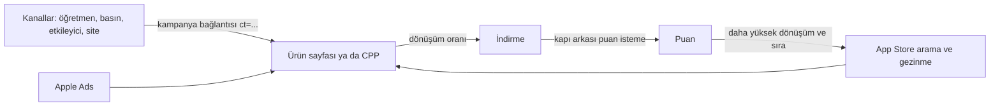

# Cobi: neredeyse sıfır bütçeyle büyüme kanalları (araştırma D)

8 Kasım 2026 · App Store kimliği 6757766966 · Kids kategorisi · sürüm 2.2.0 · bütün kaynaklara 8 Kasım 2026'da erişildi.

Bu rapor iki önceki raporu tekrar etmez: `plan/pazarlama-incelemesi-2026-11-03.html` (30 günlük yayın planı, puan isteme kuralları 5.4, adaylık metni 4.3, Apple Ads kararı 5.3) ve `plan/isim-arastirmasi-2026-11-07.html` (ad ve arama sırası). Burada yalnız yeni bulgular, düzeltmeler ve 90 günlük sıralama var.

Kısaltmalar (ilk geçtiği yerde de açılır): CPT dokunma başı maliyet, CPI kurulum başı maliyet, CR dokunmadan kuruluma dönüşüm oranı, TTR gösterimden dokunmaya oran, CPP özel ürün sayfası (Custom Product Page), PPO ürün sayfası testi (Product Page Optimization), ASC App Store Connect, ASM Apple School Manager, IAP uygulama içi satın alma.

---

## 0. Sonuç

**Karar: 90 günün birinci işi puan, ikincisi ölçüm, üçüncüsü Apple'ın verdiği 100 $ reklam kredisi.** Uygulamanın puanı yok; ürün sayfası dönüşümü ve sıralama en çok buna bağlı. Para harcamadan ölçülebilir kurulum getiren tek kanal Apple Ads kredisi.

- **Puan isteme (soru 1).** Apple, Kids uygulamasında puan isteme penceresini yasaklayan ya da kapı şartı koyan açık bir kural yazmıyor. Bu pencere yüzünden reddedilmiş bir uygulama kaydı da bulamadım. Yine de pencereyi yalnız ebeveyn alanında, kapıdan sonra çağır. Gerekçe: 1.3 maddesi "çocuğun dikkatini dağıtan başka şeyleri" kapı arkasına alıyor ve okuma bilmeyen çocuk yıldızlara rastgele basabilir. `action=write-review` bağlantısı uygulama dışına çıkar; bu yüzden kesin olarak kapı arkasında durmalı.
- **Apple Ads (soru 2).**
  - Hesap ve ödeme: Türkiye'de Aralık 2024'ten beri açık. Asgari harcama yazmıyor. Hesap TL ile açılamıyor; para birimi USD ya da EUR olur. Bütçe Haziran 2026'dan beri yalnız günlük.
  - Kredi: yeni reklamverene tek seferlik **100 $ kredi** veriliyor (Apple yardım sayfası, 2026).
  - Kids kuralı: Kids uygulamalarını reklamdan dışlayan bir hüküm bulamadım.
  - Maliyet: Türkiye'de ortalama CPT 0,85 $ (MobileAction, 2025 verisi), CPI 1,02 $ (AppTweak, 2025 verisi). Kredi yaklaşık 55–100 kurulum eder. "boyama" sözcükleri için herkese açık CPT verisi yok.
- **Editoryal yüzeyler (soru 3).**
  - Öne çıkarma adaylığı: Apple en az 2 hafta öncesini istiyor; ASC yardımı 3 hafta öneriyor; geniş değerlendirme için 3 ay önce. Kış içeriği adaylığı için son gün 24 Kasım 2026; 23 Nisan 2027 adaylığı için 23 Ocak 2027.
  - Uygulama içi etkinlik: Kids yasağı bulamadım, ama etkinlik gerçek ve süreli bir uygulama içi içerik ister.
  - CPP: 70'e çıktı ve anahtar kelime atanabiliyor. Cobi'deki asıl değeri, her kanalın dönüşümünü SDK'sız ayrı ölçmek.
  - PPO: bugünkü trafikle 90 günde ancak %50'nin üstündeki farkı yakalar; şimdi değil.
- **Türkiye kanalları (soru 4).** Doğrulanmış ve ücretsiz en iyi yollar:
  - öğretmen siteleri (Annenin Okulu'nun "İçerik Gönder" sayfası),
  - tanıdık özel kreşler,
  - küçük ebeveyn podcastleri,
  - "çocuklar için eğitici uygulamalar" liste yazıları.

  Facebook gruplarını giriş yapmadan doğrulayamadım. Kadınlar Kulübü erkek üye kabul etmiyor. Devlet okulu öğretmenine ücret ya da ürün teklif etme. Okulda marka tanıtımı 2026–2027 genelgesiyle yasak.
- **Mevzuat.** 1 Ağustos 2026'dan beri etkileyici paylaşımında "Reklam/Tanıtım" ibaresi reklam verenin adıyla ve öbür etiketlerden önce yazılmalı. Hediye ürün de reklam sayılır. Çocuğa profilleme ile hedefli reklam yasak.
- **Yazdırılabilir sayfalar (soru 5).**
  - Talep: Google'da "boyama sayfası" araması "boyama oyunu" aramasının yaklaşık 4 katı.
  - Sezon: Ekim–Şubat yüksek, zirve Aralık.
  - Sınırlar: sayfadan kuruluma dönüşüm verisi yok ve baş terimler dolu.
  - Değeri: uzun kuyruk aramalarda kalıcı görünürlük ve öğretmene verilecek hediye.
  - Lisans: her PDF'te MIT atfı şart.
- **Okullar (soru 6).** Türkiye'de ASM yalnız "Apps" sunuyor ve ödeme kartla. IAP cihaza atanmış uygulamada çalışmıyor. Eğitim indirimi ve özel uygulama seçenekleri Apple'ın sayfasına göre yalnız "onaydan önce" seçilebiliyor. 90 gün içinde okul sürümü önermiyorum.
- **İlk 5 kanal (soru 7):**
  1. Kapı arkası puan isteme ve yorum yanıtı.
  2. Apple Ads 100 $ kredi testi (yalnız Türkiye).
  3. Öğretmen ve özel kreş kanalı (PDF ve kampanya bağlantısı).
  4. Öne çıkarma adaylığı (yeni içerik varsa uygulama içi etkinlikle).
  5. Ödemesiz mikro etkileyici ve podcast.

  Bunlardan önce 3 saatlik ölçüm altyapısı kurulur: kampanya bağlantıları ve 3 CPP.

---

## 1. Puan isteme Kids kategorisinde serbest mi, kapı şart mı (soru 1)

**Karar: Serbest; kapı Apple'ın açık şartı değil ama tek güvenli yer. Pencereyi yalnız ebeveyn alanında, kapıdan sonra çağır.**

### 1.1 Apple ne diyor

| Kaynak | Söylediği | Cobi için anlamı |
|---|---|---|
| Review Guidelines 1.3 | Kids uygulamasında dış bağlantı, satın alma fırsatı ve "çocuğu dağıtan başka şeyler" yalnız kapı arkasındaki alanda olabilir. | Sistem penceresi metin içerir ve çocuğun akışını keser. "Dağıtan şey" sayılabilir. |
| Review Guidelines 5.6.1 | Puan için Apple'ın API'si kullanılır; özel puan penceresine izin verilmez. | Kendi "beğendin mi?" pencereni yapma. |
| `RequestReviewAction` belgesi | Cihazda puan verilmediyse pencere 365 günde en çok 3 kez çıkar. Puan verildiyse yalnız yeni sürümde ve önceki puandan 365 gün sonra çıkar. Düğmeye bağlanmaz. TestFlight'ta çalışmaz. Ayarlarda kalıcı `action=write-review` bağlantısı konabilir. | İlk çağrı en iyi ana saklanır. TestFlight'ta denenemez; geliştirme derlemesinde her seferinde görünür. |
| HIG, Ratings and reviews | İlk açılışta ve iş ortasında isteme. Doğal duraklamada iste. İki istek arasında "bir iki hafta" bırak. | Kapıdan sonra, ebeveynin başlattığı iş bitince. |
| developer.apple.com/kids | Kapının amacı izinsiz IAP'yi ve uygulama dışına bağlantıyı önlemek. Puan ve yorumdan söz etmiyor. | Pencere için açık kural yok; `write-review` bağlantısı dış bağlantı olduğu için kapı şart. |
| Ratings, reviews and responses | Puan özeti ülke (vitrin) bazında tutulur ve sıfırlanır. | Türkiye puanı ABD vitrininde görünmez. ABD için ayrıca ABD'li kullanıcı gerekir. |

### 1.2 Belgelenmiş ret

Apple geliştirici forumlarında, Reddit kopyalarında, GitHub sorunlarında ve RevenueCat'in ret rehberinde (Haziran 2024 güncellemesi) aradım. Kids uygulamasının puan isteme penceresi yüzünden reddedildiği bir kayıt bulamadım.

Bulunan 1.3 retleri başka konularda: kapısız bağlantı, kapısız satın alma, üçüncü taraf analiz, App Tracking Transparency. Bir forum sorusu, eski Kids sayfasında "izin istemenin de kapı arkasında olması" gerektiğini alıntılıyor ve yanıtsız kalmış (thread 654621). Açık kaynak bir çocuk oyunu (kids-games, PR #95, 24 Ekim 2026) pencereyi yalnız kapı arkasındaki Ayarlar'da çağırıyor. Bu bir geliştiricinin kendi yorumu, Apple metni değil.

### 1.3 Zamanlama (önceki planın 5.4 bölümüne ek)

Önceki plandaki tetik geçerli: ebeveyn bir resmi paylaştıktan, kaydettikten ya da yazdırdıktan sonra; kurulumdan en az 3 gün ve en az 3 kayıtlı eser sonra. Yeni bulgulara göre eklenecekler:

1. **İlk çağrı tek ve değerli.** Sistem 365 günde 3 kez gösterir. Çağrıyı paylaşım menüsü "tamamlandı" döndüğünde yap; iptal edildiğinde yapma.
2. **İkinci çağrı en az 14 gün sonra** ve yeni bir paylaşımdan sonra (HIG: "bir iki hafta").
3. **Kalıcı "Puan ver" satırı** Ebeveynler alanında, kapının arkasında. Bağlantı `https://apps.apple.com/app/id6757766966?action=write-review`. Sistem penceresi kotası dolsa da çalışır.
4. **Sürüm notunda puan isteme yazma.** 5.6.3 keşif sahtekârlığı: teşvik yok, tanıdıklara ödül yok.
5. **Ölçüm:** ASC > Ratings and Reviews, ülke filtresiyle haftada bir. Ek olarak Analytics'te dönüşüm oranı (gösterimden indirmeye). Apple'ın verdiği ortalama varsayılan ürün sayfası dönüşümü %1,6. Cobi'nin ilk günlerdeki ~%1,7'si aynı metrikse ortalamada. Bunu ASC'de metrik adına bakarak doğrula.

### 1.4 Doğrulanamayanlar

- 13 yaş altı çocuk hesabıyla açılmış bir cihazda pencerenin görünüp görünmediği ve verilen puanın sayılıp sayılmadığı. 3–5 yaş çoğunlukla ebeveynin cihazını ya da hesabını kullandığı için etkisi sınırlı olabilir.
- Uygulamada bugün puan isteme kodu yok (`pubspec.yaml`'da `in_app_review` yok; `lib/` içinde `requestReview` ya da `write-review` geçmiyor).

---

## 2. Apple Ads Türkiye'de (soru 2)

**Karar: 100 $ kredi açıkken ilk test ücretsiz. Puan isteme yayına girdikten sonra yalnız Türkiye'de, tam eşleşmeyle, günlük 3 $ bütçeyle bir kez dene. ABD kredi için pahalı.**

### 2.1 Durum

| Konu | Bulgu | Kaynak |
|---|---|---|
| Türkiye'de ne zamandan beri | 2–3 Ekim 2024'te duyuruldu. 3 Aralık 2024'te açıldı. Apple'ın ülke listesinde Türkiye "Europe" altında, hem vitrin hem reklamveren ülkesi olarak geçiyor. | 9to5Mac (2 Ekim 2024), MobileAction 2025 rapor sayfası, ads.apple.com/app-store/countries-and-regions |
| Asgari harcama | Apple'ın fiyat, Basic ve ödeme sayfalarında asgari harcama yok. Basic'te üst sınır uygulama başına ayda 10.000 $. Advanced'te üst sınır yok. | ads.apple.com fiyat ve karşılaştırma sayfaları |
| Bütçe modeli | Yalnız günlük bütçe. Ömür boyu bütçeli kampanyalar Haziran 2026'da durduruldu. Aylık harcama günlük bütçe × 30,4'ü geçmez, ama tek bir gün günlük bütçeyi aşabilir. | ads.apple.com/app-store/help/bids-and-budget/0016-manage-budgets |
| Para birimi ve ödeme | Hesap para birimi listesinde TRY yok: AUD, GBP, CAD, EUR, JPY, MXN, NZD, USD, ayrıca yalnız yerel müşterilere RMB ve INR. Para birimi sonradan değişmez. Ödeme Visa, Mastercard, Amex ya da PIN'siz banka kartıyla. Ön ödemeli kart ve PayPal kabul edilmiyor. | ads.apple.com/app-store/help/get-started/0030-set-your-payment-method |
| Tanıtım kredisi | Yeni App Store reklamverenine tek seferlik 100 $ kredi (USD dışı hesapta karşılığı). Şart: ASC hesap sahibi olmak ve en az bir uygulamanın satışta olması. Hesap en üst düzeyde bağlanmalı. Bitiş tarihi sayfada yok. | ads.apple.com/app-store/help/billing/0032-apple-ads-promo-credit |
| Kids kategorisi | Apple Ads politikaları (26 Şubat 2025), Basic sayfası ve "uygulamam görünmüyor" sorun giderme sayfasında Kids uygulamasını dışlayan hüküm yok. Uygunluğu hesapta görürsün. | ads.apple.com/policies, ilgili yardım sayfaları |
| Hedefleme kısıtları | Hesabı 13 yaş altına kayıtlı kullanıcıya ve Yönetilen Apple Hesabına reklam gösterilmez. Hedeflenebilen en küçük yaş ABD ve Avrupa'da 18. Yaş ya da cinsiyet daraltması, kişiselleştirilmiş reklamı kapalı olanları dışarıda bırakır. Reklam zaten ebeveyne gider; daraltma yapma. | ads.apple.com/app-store/help/ad-groups/0021-modify-audience-settings |
| Arama sonucunda daha çok reklam | 3 Mart 2026'dan itibaren arama sonuçlarının arasına ek reklam yerleri geldi. Yer seçilemez. Araya reklam girdiği için organik sonuçlar aşağı kayar (benim çıkarımım). | MacRumors (23 Ocak 2026) |
| Uygulama adı | Apple, adında aksanlı harf olan uygulamanın reklam arayüzünde aranırken görünmeyebileceğini yazıyor. "Çocuk Boyama Oyunları" bu durumda; adı mağazadaki gibi yaz. | ads.apple.com sorun giderme sayfası |

### 2.2 Maliyet verisi

"boyama", "çocuk boyama" ya da "coloring" için anahtar kelime düzeyinde herkese açık CPT verisi bulamadım. Elimdeki en yakın veri ülke ve kategori ortalamaları:

| Metrik (arama sonucu reklamı, 2025 verisi) | Türkiye | ABD | Kaynak |
|---|---|---|---|
| CPT (dokunma başı maliyet) | 0,85 $ (listede en düşük) | 1,93 $ | MobileAction 2026 raporu |
| CPI (kurulum başı maliyet) | 1,02 $ | 4,06 $ | AppTweak (19 Ağustos 2026) |
| CR (dokunmadan kuruluma) | %48 | %55 | AppTweak |
| TTR (gösterimden dokunmaya) | %9,2 | %6,6 | AppTweak |
| Education kategorisi | — | CPT 1,52 $, CPI 2,91 $, CR %56,4 (ABD medyanı) | AppTweak |

MobileAction'a göre Education kategorisinde 2025'te TTR %8,44, CR %61,63. Ortalamalar çoğunlukla puanı olan uygulamalardan gelir (benim varsayımım); puansız bir uygulamada CR daha düşük olabilir.

**Kredinin getirisi (kendi hesabım).** Türkiye'de 100 $ ÷ 0,85 $ ≈ 118 dokunma × %48 ≈ 56 kurulum. CPI'dan hesaplanınca 100 $ ÷ 1,02 $ ≈ 98 kurulum. ABD'de aynı kredi yaklaşık 25–30 kurulum eder. Bu yüzden krediyi Türkiye'de kullan.

### 2.3 Test planı (önceki plandaki "satın alma açılınca test" kararının yerine)

Önceki planın gerekçesi, satın alma kapalıyken harcamanın geri dönüşünün ölçülemeyeceğiydi. Kredi bu gerekçeyi değiştiriyor: nakit çıkmıyor ve test üç ölçülebilir şey getiriyor. Kurulum, arama terimi raporu (insanların gerçekte ne yazdığı) ve anahtar kelime popülerliği.

1. **Zaman:** Puan isteme kodu yayına girdikten sonra, 3. hafta. Gelen kullanıcıdan puan da alınsın.
2. **Kurulum:** Advanced arayüzü, yalnız Türkiye, para birimi USD. Kredi USD cinsinden ve para birimi sonradan değişmez.
3. **Anahtar kelimeler (tam eşleşme):** çocuk boyama oyunları, çocuk boyama oyunları internetsiz, boyama oyunu internetsiz, reklamsız çocuk oyunları, 3 yaş boyama, okul öncesi boyama, çocuklar için boyama oyunu, çocuk boyama. Ayrıca düşük teklifli bir keşif (search match) grubu: arama terimi raporu için.
4. **Teklif:** Apple'ın önerdiğinin altından başla. Türkiye ortalaması 0,85 $; 1 $'ın üstüne çıkma.
5. **Bütçe:** Günlük 3 $. Aylık en çok 3 × 30,4 = 91 $, kredinin altında. Kredi bitince kampanyayı elle durdur. Kart kayıtlı olduğu için kredi dışı harcama riski var.
6. **Bırakma ölçütü:** 14 günde 20 kurulum gelmezse ya da CPI 2 $'ı geçerse dur.
7. **Ölçüm:** Apple Ads raporu (dokunma, kurulum, arama terimi), ASC'de "App Store search" kaynağı ve CPP filtresi.

Doğrulanamayan: Türk kartıyla USD hesabına KDV eklenip eklenmeyeceği ve bankanın döviz komisyonu.

---

## 3. App Store editoryal yüzeyleri (soru 3)

### 3.1 Öne çıkarma adaylığı (Featuring Nomination)

**Karar: 2.2.0'ın "App Launch" anı geçti. Bundan sonra her büyük içerik sürümü için "New Content", Manzara ya da ses klipleri için "App Enhancements" adaylığı gönder.**

Form alanları (ASC yardımı):

| Alan | İçerik |
|---|---|
| Name | Akılda kalan bir adaylık adı |
| Type | New Content (yeni içerik, teklif, etkinlik) · App Enhancements (yeni özellik, önemli güncelleme) · App Launch (yeni uygulama ya da ön sipariş) |
| Description | Ne değişti, amacı, öncelik düzeyi, hedefi |
| Publish date | Tek gün ya da aralık |
| Additional information | İlgili uygulamalar (en çok 10), platformlar, ülkeler, yerelleştirmeler, bağlı uygulama içi etkinlik, ek materyal (en çok 5 URL: belge, görsel, herkese açık TestFlight bağlantısı), yararlı ayrıntılar (erişilebilirlik, kapsayıcılık, ekip) |
| Roller | Account Holder, Admin, App Manager, Marketing |
| Gönderdikten sonra | Tür ve ilgili uygulamalar değiştirilemez, öbür alanlar değiştirilebilir |

Süre ve sonrası:

- **Süre:** "Getting Featured" sayfası en az iki hafta öncesini istiyor. Geniş değerlendirme için üç ay öncesine kadar gönderilebiliyor. ASC yardımı en az üç hafta öneriyor.
- **Bildirim:** Uygulama Today sekmesinde "Günün Uygulaması" gibi bir yerde öne çıkarsa ASC uygulamasına bildirim gelir. Değerlendirmeye alınan uygulamanın Admin, App Manager ve Marketing rollerine e-postayla tanıtım görseli istenebilir.
- **Yerli seri:** Apple'ın Türkiye'de yerli uygulamaları öne çıkaran "Yeni ve Yerli" serisi 29 Ekim 2019'da başladı (Webrazzi). 2026'da sürüp sürmediğini doğrulayamadım.

Takvim (Apple'ın 3 haftalık önerisine göre):

| Hedef | Yayın | Adaylık son günü | Tür |
|---|---|---|---|
| Kış ve yılbaşı içeriği (katalogda 7 kış sayfası var: kar bulutu, kardan adam, kar tanesi, karlı dağ, paketlenmiş hediye, Noel ağacı, atkı; yeni sayfa eklenirse daha güçlü) | 15 Aralık 2026 | 24 Kasım 2026 | New Content |
| 23 Nisan 2027 (Türkiye) | 20–23 Nisan 2027 | 23 Ocak 2027 (3 ay önce, geniş değerlendirme) | New Content ya da App Enhancements |
| Ses klipleri / Manzara (hazır olunca) | Sürüm günü | Sürümden 3 hafta önce | App Enhancements |

20 Kasım Dünya Çocuk Hakları Günü için süre 12 gün kaldı; iki haftalık en kısa sürenin altında. Adaylık metninin içeriği önceki planın 4.3 bölümünde; yalnız türü ve tarihi güncelle.

### 3.2 Uygulama içi etkinlik (In-App Event)

**Karar: Kids uygulamasının etkinlik açmasını yasaklayan bir hüküm bulamadım. Etkinliği yalnız gerçek, süreli yeni içerikle aç. Var olan sayfaları "Kış haftası" diye sunmak ret riski taşır.**

| Kural | Değer |
|---|---|
| Rozetler | Challenge, Competition, Live Event, Major Update, New Season, Premiere, Special Event |
| Metin sınırları | Ad 30, kısa açıklama 50, uzun açıklama 120 karakter. Fiyat ve doğrulanamayan iddia yok. Görselde yazı ve logo önerilmez. |
| Süre | Etkinlik en çok 31 gün sürer. Başlamadan en çok 14 gün önce tanıtılır. |
| Sayı | ASC'de aynı anda en çok 15 onaylı, mağazada en çok 10 yayımlanmış etkinlik |
| Görsel | Kart 16:9 (en az 1920×1080), ayrıntı sayfası 9:16 (en az 1080×1920); görüntü ya da video |
| İnceleme | Sürümden bağımsız gönderilir. 29 Ekim 2025'ten beri sürüm incelemedeyken de ayrı gönderilebiliyor. |
| 2.3.13 | Etkinlik uygulamanın içinde, belirtilen tarihlerde olmalı. Metin genel uygulamayı değil etkinliği anlatmalı. Derin bağlantı doğru yere götürmeli. |
| Nerede görünür | Ürün sayfası, arama sonuçları (uygulaması olmayanlar dahil), Today, Games ve Apps sekmelerindeki seçkiler |
| Ölçüm | ASC Analytics: etkinlik gösterimi, ayrıntı sayfası görüntüleme, uygulama açma, etkinliğe göre indirme, bildirim isteyen kişi sayısı |

Cobi için uygun biçim: yeni sayfalarla gelen bir sürüm (ör. kış sayfaları) için **Major Update** ya da **New Season** rozetli bir etkinlik. Etkinlik, adaylığa da bağlanır.

Gereken iş:

- iki görsel (kart ve ayrıntı sayfası),
- uygulamada yeni kategoriyi açan bir derin bağlantı,
- etkinlik metni.

Tahminim 5 saat.

Dikkat: 3 Kasım kurulu "sezon kategorisi"ni erteledi. Süreli bir kış rafı ürün kararıdır; kurul kararına aykırı düşmemesi için yeni sayfaları kalıcı kategoriye ekleyip etkinliği yalnız duyurunun 31 günlük penceresi olarak kullan.

### 3.3 Özel ürün sayfası (CPP)

**Karar: 3 CPP aç. Amaç arama sırası değil; her kanalın dönüşümünü ayrı ölçmek ve mesajı kanala göre değiştirmek.**

- En çok 70 CPP (29 Ekim 2025'te 35'ten 70'e çıktı). Ekran görüntüsü, tanıtım metni ve önizleme değişebilir. Her CPP'nin kendine özgü URL'si (`ppid` parametresi) var. Uygulamaya derin bağlantı iOS 18 ve üstünde çalışır. İnceleme sürümden bağımsız.
- Anahtar kelime atanabiliyor: CPP o anahtar kelimenin aramasında varsayılan sayfanın yerine çıkar. Her anahtar kelime kombinasyonu tek sayfaya atanır. Apple'ın sayfası hangi sözcüklerin seçilebildiğini yazmıyor. İkincil kaynaklara göre seçim mevcut anahtar kelime alanından yapılıyor; doğrulamadım. Cobi bu aramalarda üst sırada olmadığı için organik etkisi şimdilik küçük.
- Apple'ın verisi: CPP'ye yönlendirilen kullanıcıda dönüşüm ortalama 2,5 puan artıyor (varsayılan sayfa ortalaması %1,6).
- Önerilen CPP'ler:

| CPP | Mesaj | Kullanıldığı kanal |
|---|---|---|
| Öğretmenler için | Okuma gerektirmez, Rehberli Erişim, yazdırılabilir sayfa | Öğretmenlere ve kreşlere giden mesajlardaki bağlantı |
| Reklamsız ve internetsiz | İnternet yok, reklam yok, hesap yok | Etkileyici ve podcast bağlantısı; Apple Ads reklam varyasyonu. İkisi ASC'de kaynak filtresiyle ayrılır. |
| Kış sayfaları | Kış sayfaları ilk karede | Aralık'ta Apple Ads reklam varyasyonu; kış adaylığı dönemi |

Kampanya bağlantıları dört tane: `pdf` (PDF'teki QR), `web` (site rozeti), `basin`, `pinterest`. Her kampanyanın verisi ancak 5 ilk indirmeden sonra göründüğü için kişi ya da yayın başına ayrı token açma.

### 3.4 Ürün sayfası testi (PPO)

**Karar: Şimdi değil.** Apple en çok 3 varyant, en çok 90 gün ve %90 güven öneriyor; asgari trafik vermiyor, ASC'de bir tahminci var. Kendi hesabım: taban dönüşüm %1,7, iki kol (asıl sayfa ve 1 varyant), trafiğin tamamı teste, %90 güven, %80 güç.

| Yakalanacak göreli fark | Gereken toplam gösterim | Gün (150 gösterim/gün) | Gün (250/gün) | Gün (500/gün) |
|---|---|---|---|---|
| %20 | 39.255 | 262 | 157 | 79 |
| %30 | 18.221 | 121 | 73 | 36 |
| %50 | 7.114 | 47 | 28 | 14 |
| %100 | 2.121 | 14 | 8 | 4 |

İlk günlerdeki yaklaşık 1.000 gösterime bakılırsa günlük trafik tablonun alt ucunda (tahmin). Günlük gösterim 500'ü geçince ASC tahmincisiyle yeniden bak. İlk test adayı ilk ekran görüntüsü (dolgu mu, kalem mi).

---

## 4. Türkiye kanalları (soru 4)

### 4.1 Ebeveyn toplulukları

| Topluluk | Ne | Etkinlik kanıtı | Uygunluk | Durum |
|---|---|---|---|---|
| Kadınlar Kulübü forumu, "Bebek / Çocuk Büyütürken" (kadinlarkulubu.com) | Büyük kadın forumu | 6–8 Kasım 2026 tarihli mesajlar | Düşük: kurallara göre erkek üye kabul edilmiyor ve reklam yapan hesap teşhir ediliyor. Ancak aileler kendiliğinden yazarsa işler. | Doğrulandı |
| Bebek.com forumu (ebebek), "3-4 Yaş", "Oyun ve Oyuncak" | Ebeveyn forumu | "Dün" ve 5 Kasım tarihli konular | Orta: yalnız öneri soran başlıkta, geliştirici olduğunu yazarak | Kısmen (kurallar sayfası 403) |
| Okul Öncesi Forum (okuloncesiforum.com) | Öğretmen ve veli forumu; 145.823 üye, "Baskı ve boyama" bölümünde 769 konu | Son konular 24 Temmuz ve 23 Ocak 2026; etkinlik düşük | Orta: PDF paylaşımı | Kısmen |
| Anneysen (anneysen.com) | Soru-cevap ve blog | En yeni soru 19 Ağustos 2025 | Düşük | Kısmen |
| Facebook grupları (Montessori, okul öncesi, anne) | — | Giriş gerektiriyor | Bilinmiyor | Doğrulanamadı |

Akademik bir kayıt, okul öncesi öğretmenlerinin Facebook'u mesleki paylaşım için kullandığını gösteriyor (55 ilden 340 öğretmen; YÖK Açık Bilim).

### 4.2 Instagram, TikTok, YouTube

| Hesap | Takipçi (kaynak, tarih) | Ne | Uygunluk | Durum |
|---|---|---|---|---|
| @cocukkalplikitapligim "Çocuk Kitapları ve Oyunlar – Bilim Uzm. Öğretmen Anne" | 225,1 B (HypeAuditor Kids & Toys Türkiye, 10. sıra; 8 Kasım 2026) | Kitap ve oyun önerisi | Yüksek | Doğrulandı |
| @belmatugrul "Prof. Dr. Belma Tuğrul" | 86,7 B (HypeAuditor, 45. sıra) | Erken çocukluk akademisyeni | Görüş almak için; ücretli iş birliği beklenmez | Doğrulandı |
| @okul.oncesietkinlik49 "Rabia Hoca" | 107 B (profil meta verisi) | Okul öncesi etkinlik hesabı (influencers.club listesi) | Yüksek: boyama etkinliği | Kısmen |
| @yeliz_gencc | 89 B (profil meta verisi) | Okul öncesi öğretmeni | Orta | Kısmen |

Bütçe dışı makro hesaplar: @haticekubratongar (4 M) ve @ogretmen.baba (2,6 M), ikisi de HypeAuditor listesinde.

Boyama içeriğinin payı: Fırat (2023), 50 binden fazla takipçili 10 okul öncesi öğretmeni hesabını inceledi. En çok paylaşılan sanat etkinliği "resimleri boyama" (%39,3). Çalışmaya göre bu hesapların bir kısmı reklam alan ticari alana dönüşmüş.

TikTok'ta hesap düzeyinde doğrulama yapamadım. Türkçe okul öncesi YouTube kanalları çocuğa konuşuyor, ebeveyne ulaşmıyor; önermiyorum.

**Risk.** MEB, şikâyetler üzerine 81 ilden "fenomen öğretmen" listesi istedi (CNBC-e, 24 Aralık 2025). Ana konu öğrenci mahremiyeti. Haber, 657 sayılı Kanun açısından ek gelirin sorun olduğunu da yazıyor. Devlet okulu öğretmenine ücret, ürün ya da kod teklif etme. Ebeveyn hesapları ve özel kurum öğretmenleri daha güvenli. Bir hesabın devlet okulunda çalışıp çalışmadığını bilmiyorsan teklif içermeyen "deneyip beğenirseniz" mesajıyla sınırlı kal.

### 4.3 Fiyat ve takas

- **Türkiye için tek kaynağım Bravery Technology (11 Nisan 2026).** Yöntem açıklanmıyor.
  - İş birliği başına: nano (1–10 bin takipçi) 1.000–4.000 TL, mikro (10–100 bin) 4.000–25.000 TL.
  - Biçime göre (kademe belirtilmeden): Story 1.500–5.000 TL, Reels 4.000–15.000 TL, TikTok 3.000–12.000 TL, YouTube içinde anma 5.000–20.000 TL.
  - Ürün karşılığı çalışmayı nano ve bazı mikro hesaplar kabul ediyor; 10 binin üstündekilerin çoğu yalnız ürünle çalışmıyor.
- **Cobi bugün ücretsiz;** verilecek bir "ürün" yok. Tam Sürüm açılınca ücretsiz bir teklif kodu takas için verilebilir (bkz. bölüm 6.3). Bu durumda paylaşım reklam sayılır.

### 4.4 Mevzuat

- **Reklam Kurulu, "Sosyal Medya Etkileyicileri Tarafından Yapılan Ticari Reklam ve Haksız Ticari Uygulamalar Hakkında Kılavuz" (2021):**
  - Ücretsiz ya da indirimli ürün verilen paylaşım da reklam sayılır (md. 5/2).
  - Etiket zorunlu (md. 8).
  - Etkileyici denemediği ürünü denemiş gibi gösteremez (md. 6/a).
  - Reklam veren, etkileyiciyi bilgilendirmekle sorumlu (md. 11).
- **Ticari Reklam ve Haksız Ticari Uygulamalar Yönetmeliğinde değişiklik** (Resmî Gazete 1 Temmuz 2026, sayı 33297; yürürlük 1 Ağustos 2026):
  - "Reklam" ya da "Tanıtım" ibaresi reklam verenin adıyla birlikte, kaydırmadan görünür ve öbür etiketlerden önce yazılır. Bu ayrıntıyı ikincil kaynaktan aldım (alomaliye.com).
  - Çocuğa yönelik, kişisel veriye dayalı profillemeyle hedefli reklam yasak (Ticaret Bakanlığı ve haberler).
- **Yönetmeliğin 24. maddesi** çocuklara yönelik reklamlara özel hükümler içeriyor (Ticaret Bakanlığı, 19 Ekim 2025). Bakanlığın özetine göre çocuğu tehlikeye yönelten, aşırı tüketimi özendiren ve çocuğun gelişim düzeyini istismar eden reklam yasak. Tam metni okumadım. Cobi'nin bütün iletişimi ebeveyne konuşmalı; çocuğa "annene indirt" dili kullanılmamalı.
- **MEB 2026–2027 eğitim öğretim yılı genelgesi** (Sabah, 5 Eylül 2026): okul ürün tanıtımı, reklam ve markaya yönlendirme için kullanılamaz. Önceki plandaki "anaokuluna QR'lı boyama çıktısı" fikri devlet okulunda bu kuralla çatışır. Haberde anasınıfı ve özel kreş ayrıca anılmıyor; özel kreşler için durumu doğrulamadım.
- **Benim okumam (hukuki görüş değil):** Ödeme, hediye ya da kod verilmeyen kendiliğinden paylaşımda etiket yükümlülüğü doğmaz. Tam Sürüm kodu verilirse "Reklam" ibaresi zorunlu.

### 4.5 Okul öncesi öğretmen toplulukları

| Kanal | Ne | Kanıt | Cobi için | Durum |
|---|---|---|---|---|
| Annenin Okulu (anneninokulu.com) | Ücretsiz günlük planlar (3–4, 4–5, 5–6 yaş). "Boyama" bölümünde 69 içerik. | Akışta 3–5 Kasım 2026 tarihli yazılar. Ana sayfada "İçerik Gönder", "Reklam", "İletişim" sayfaları ve bir WhatsApp grubu bağlantısı var. | Yüksek: MIT atıflı PDF seti "İçerik Gönder" ile. Sitenin içerikte uygulama bağlantısına izin verip vermediği bilinmiyor. | Doğrulandı |
| Egitimhane (egitimhane.com, okul öncesi dosyaları) | Öğretmen dosya paylaşımı. Örnek: "2025-2026 Okul Öncesi Uyum Haftası" dosyası 512 kez indirilmiş. | Cloudflare arkasında; kurallar okunamadı | Orta | Kısmen |
| EBA ve ÖBA | MEB platformları; öğretmen materyalleri yayımlanıyor | Özel uygulama için başvuru yolu yok | Düşük | Başvuru yolu doğrulanamadı |

### 4.6 Ebeveyn siteleri ve podcastler

Siteler:

- **cocukgelisimi.com:** akışta 5–7 Kasım 2026 tarihli yazılar var. Kısmen doğrulandı.
- **bebek.com:** Haziran 2026 tarihli yazılar var. Kısmen doğrulandı.
- **Liste yazıları** (Cobi'nin girmeye aday olduğu yazılar): Webtekno, "çocuklar için en iyi eğitici tablet uygulamaları" (7 Kasım 2025) ve Oggusto, "çocuklar için eğitici mobil uygulamalar" (18 Şubat 2026). İkisinde de boyama uygulaması yok. Bu boşluk "güncelleme" önerisinin açısı.

Podcastler: Apple Podcasts arama API'siyle 8 Kasım 2026'da doğrulandı. Hiçbirinin dinlenme sayısı herkese açık değil.

| Podcast | Sunucu | Bölüm | Son bölüm | Bağlantı |
|---|---|---|---|---|
| Sıfır Km Annelik | Sıfır Km Annelik | 59 | 7 Kasım 2026 | podcasts.apple.com/tr/podcast/id1551072798 |
| Pusulanda Ebeveynlik | (çocuk gelişimci) | 23 | 2 Kasım 2026 | podcasts.apple.com/tr/podcast/id1835459134 |
| Annelik Halleri | Betül Çağlarca | 18 | 4 Kasım 2026 | podcasts.apple.com/tr/podcast/id6820228689 |
| Global Ebeveynlik Pusulası | Çocuğun Dünyasına Eşlik Edenler | 41 | 2 Kasım 2026 | podcasts.apple.com/tr/podcast/id1776570930 |
| Anne Baba Kafası | Brainfit | 11 | 15 Ekim 2026 | podcasts.apple.com/tr/podcast/id6799457625 |
| Annelik ve Toplum | Arca Begüm Bayır | 17 | 9 Ağustos 2026 | podcasts.apple.com/tr/podcast/id1890003257 |

Konu önerisi ürün tanıtımı olmamalı. Örnek: "3–5 yaş için reklamsız, verisiz uygulama nasıl seçilir". Pedagog Adem Güneş podcasti Mart 2025'ten beri yeni bölüm yayımlamıyor.

### 4.7 Teknoloji ve girişim basını

Hepsinin akışında 5–8 Kasım 2026 tarihli yazı var.

| Yayın | Herkese açık yol | Durum |
|---|---|---|
| egirişim | İletişim formunda "Girişimimi eklemek istiyorum" ve "Genel Haber / basın bülteni" seçenekleri; ayrıca girişim başvurusu sayfası | Doğrulandı |
| ShiftDelete.Net | İletişim formunda "Haber ihbarı" seçeneği; info@shiftdelete.net | Doğrulandı |
| Webtekno | İletişim formunda "İçerik Departmanı" seçeneği | Doğrulandı |
| Donanım Haber | iletisim@donanimhaber.com | Doğrulandı |
| Webrazzi | Eski bir yazıda (2017) ücretsiz girişim formu anılıyor; form sayfası 403 verdi | Kısmen |
| Teknoblog, Log, Technopat | Etkin; iletişim yolu bulunamadı ya da 403 | Kısmen |

Hazır haber açısı: basın, App Store'un Türk çocuk uygulamalarını öne çıkarmasını haber yapıyor. Örnek: 23 Nisan'da Kidly, Tiny Minies ve MentalUP Bugün sekmesine çıktı (ShiftDelete, 22 Nisan 2023). Cobi'nin açısı: yerli, reklamsız, verisiz, 3 yaşa göre.

### 4.8 "Günün uygulaması" listeleri

- ShiftDelete'in "Haftanın iOS Uygulamaları" ve Webtekno'nun ücretsiz uygulama listeleri için bulduğum yazılar 2016–2021 tarihli. Seriler durmuş görünüyor.
- Tamindir "… Ücretsiz Oldu" haberlerini sürdürüyor (16 Eylül 2025), ama bu listeler yalnız ücretliyken geçici ücretsiz olan uygulamaları alıyor. Cobi zaten ücretsiz.
- **Uygunluk düşük; atla.**

---

## 5. Ücretsiz yazdırılabilir sayfalar (soru 5)

**Karar: Hızlı indirme getirmez; kalıcı arama varlığı ve öğretmene hediye olarak değerli. İlk iş 20 Türkçe sayfa ve kış seti; Aralık zirvesine yetiştir.**

### 5.1 Kids uygulamalarında işe yarıyor mu

- **Büyük şirketler bu huniyi kullanıyor.** ABCmouse'un ücretsiz boyama sayfaları bölümünün menüsünde "Download App" var. RV AppStudios ayrı bir boyama sitesinde App Store ve Play bağlantısı veriyor. Crayola ücretsiz sayfa yayımlıyor ama App Store bağlantısı koymuyor.
- **Dönüşüm verisi yok.** Hiçbir kaynak yazdırılabilir sayfadan kuruluma geçiş oranı yayımlamıyor. En yakın veri bir Flippa satış ilanı: ayda yaklaşık 240 bin tekil ziyaretçili bir boyama sitesi ve 10 uygulama, ama trafik kaynağı ve uygulama payı yok (satıcı beyanı).
- **Pinterest'in 2026 ebeveyn raporu (24 Şubat 2026).** Yıllık arama artışları: "screen free activities" +%200, "educational activities for kids" +%280, "art and craft activities for kids" +%330, "free road trip printables" +%220. Boyama sayfası ayrı geçmiyor; rapor ülke belirtmiyor.
- **Bu kitle ekransız etkinlik arıyor.** Mesaj "kâğıtta da, tablette de; reklamsız, internetsiz" olmalı.

### 5.2 Türkiye'de talep (Google Trends, son 5 yıl, haftalık, göreli 0–100)

| Bulgu | Değer |
|---|---|
| 5 yıllık ortalama | "boyama sayfası" 57, "boyama oyunu" 14. 8 Kasım'da yeniden ölçtüm: 56,5 ve 13,9. |
| Yön | "boyama sayfası" yıllık ortalaması 2022'de 43,6, 2023'te 49,5, 2024'te 63,5, 2025'te 68,0; 2026'da bugüne kadar 58,3. Son 12 hafta geçen yılın aynı döneminden %6 düşük. |
| Mevsim | En düşük Temmuz (40) ve Ağustos (43). Ekim–Şubat 61–70. Zirve Aralık (70). 1–7 Kasım 2026 haftası 86. |
| Tema zirveleri | 23 Nisan, 29 Ekim, Ramazan başı, Anneler Günü, yılbaşı |
| İlgili sorgular | En çok: "boyama sayfası pdf", "okul öncesi boyama sayfası", "araba boyama", "bebek boyama sayfası", lisanslı karakterler. Yükselen: "5-6 yaş boyama sayfaları pdf", "boyama sayfası pdf" (+%450), "5 yaş boyama sayfaları" (+%250), "eğitimhane". |
| Mutlak hacim (tek kaynaklı tahmin, RankHero) | "boyama" ayda 90.500, "boyama sayfası" 49.500, "boyama kitabı" 8.100, "çocuk boyama" 6.600 |
| ABD ölçeği (RankHero) | "coloring pages" ayda 823 bin, "coloring pages for kids" 301 bin, "printable coloring pages" 135 bin. Trends'te ABD talebi son 12 haftada yıllık %21 düşük. |

Lisanslı karakter kullanılamaz. "PDF", yaş ve "okul öncesi" kalıpları katalogla örtüşüyor.

### 5.3 Rekabet

Google'ın sonuç sayfasını alamadım (JavaScript istiyor). Vekil olarak Brave'in Türkçe sonuçlarına baktım. "boyama sayfası" aramasında Canva, okuloncesitr.net, YouTube, HP Printables, boyama-sayfasi.com, boyamaonline.com ve Milliyet Çocuk gibi yıllanmış siteler üstte.

Benim tahminim: github.io altındaki yeni bir site 90 günde baş terime çıkmaz. Fırsat uzun kuyrukta ("[konu] boyama sayfası", "3 yaş", "okul öncesi pdf") ve Google Görseller'de.

### 5.4 Pinterest (ABD kanalı)

- **Türkiye'de ölçülmüyor.** DataReportal'ın Digital 2026 Turkey raporu Pinterest verisi vermiyor. Türkiye'de web kanalı Google arama ve Google Görseller.
- **Uygulama pini yok.** Rich Pin türleri yalnız article, product ve recipe. Kampanya hedefleri sayfasında uygulama kurulum hedefi yok. İkincil kaynakların andığı "App Promotion" betasını doğrulamadım.
- **Kurulum ölçümü kullanılamaz.** Pinterest'te kurulum ölçümü bir MMP'yle yapılıyor (kurulumu ölçen üçüncü taraf SDK). 1.3, Kids uygulamasında üçüncü taraf analizi yasaklıyor; yalnız organik pin kullanılabilir.

### 5.5 Hukuk: Fluent UI Emoji, MIT lisansı

- Lisans MIT, "Copyright (c) Microsoft Corporation". Telif bildirimi ve izin metni bütün kopyalara ve önemli parçalara eklenmeli. Repo arşivlenmemiş; son push 24 Ağustos 2026.
- README'de marka ya da hariç tutma notu yok. Clippy ve Windows logolu iki emoji hiç yayımlanmadı (XDA, 10 Ağustos 2022).
- Microsoft'un marka listesinde "Fluent Design" var. Ürünü tanımlamak için adı metinde anmak serbest. Onay ima etmek ve markayı site, alan adı ya da hesap adına koymak yasak. Site adında "Fluent" geçmesin.
- Öneri (hukuki görüş değil):
  - Her PDF'in altına tek satır: "Çizimler Fluent Emoji'den uyarlanmıştır, © Microsoft Corporation, MIT Lisansı" ve lisans bağlantısı.
  - PDF'in son sayfasına tam MIT metni.
  - Sitede bir lisans sayfası.
  - Uygulama atfı zaten gösteriyor (`lib/main.dart`); `docs/` sitesinde atıf yok.

### 5.6 Huni ve ölçüm

- **Site yapısı (`docs/`, bugün yalnız `index.html` ve `privacy_policy.html` var):** `/boyama/` → kategori → konu sayfası.
  - Her sayfada benzersiz başlık, 80–150 kelime gerçek metin, alt metinli görsel ve A4 PDF.
  - Google'ın "scaled content abuse" kuralı yüzünden 323 sayfayı birden açma. İlk 20–30 sayfa aranan konulardan olsun: araba, itfaiye, polis arabası, T-Rex, tek boynuzlu at, kedi, köpek ve 7 kış sayfası.
- **Smart App Banner** (`<meta name="apple-itunes-app" content="app-id=6757766966">`) yalnız iOS Safari'de görünür. Kampanya sözdizimini Apple belgede açıkça vermiyor; 2026'da iki geliştirici banner kampanya verisinin ASC'de görünmediğini yazdı.
- **Görünür bir rozet de koy.** Rozet bağlantısı kampanya bağlantısı olsun: `https://apps.apple.com/app/apple-store/id6757766966?pt=<PT>&ct=web&mt=8`. PDF'in altına `ct=pdf` taşıyan bir QR kodu ekle.
- **Ölçüm kuralları (ASC yardımı):**
  - Kampanya verisi açılıştan en az 24 saat sonra ve en az 5 kişiden ilk indirme gelince görünür. Bu yüzden az sayıda token kullan.
  - Tıklamadan sonraki 24 saat içindeki ilk indirme kampanyaya sayılır.
  - Safari'den gelen tıklama "Web referrer" altında site adıyla görünür. iOS'ta Chrome'dan gelen tıklama "App referrer: Chrome" olur.
- **Siteye çerez ve analiz kodu koyma.** "Veri toplanmaz" vaadiyle tutarlı kalsın.

---

## 6. Okullar ve kurum satışı (soru 6)

**Karar: 90 gün içinde okul sürümü yok. Tam Sürüm açılınca öğretmene ücretsiz, kullanım sınırlı teklif kodu ver. Bir özel kreş zinciri gerçek talep gösterirse ayrı ücretli uygulamayı o zaman düşün.**

### 6.1 Apple School Manager Türkiye'de

| Konu | Bulgu | Kaynak |
|---|---|---|
| Türkiye'de ne var | Volume Store içeriği yalnız "Apps" (kitap yok). Ödeme American Express, Mastercard, Visa. VPP kredisi listede yok. Sayfa 14 Nisan 2026 tarihli. | support.apple.com/102867 |
| Fiyat | App Store'daki her uygulama ASM'de aynı fiyatla toplu alınabilir; geliştiricinin bir şey yapması gerekmez. | developer.apple.com/custom-apps |
| Eğitim indirimi | Geliştirici, 20 ve üstü adet alan eğitim kurumuna liste fiyatının %50'siyle satmayı seçebilir. Apple'ın notuna göre bu seçenek yalnız uygulama onaylanmadan önce kullanılabilir. Cobi'nin onaylı bir sürümü olduğu için bu seçeneğin bugün açık olup olmadığını ASC'de "Pricing and Availability > App Distribution Methods" altında kontrol et; doğrulayamadım. | developer.apple.com/custom-apps |
| Özel uygulama (Custom App) | Belirli kuruma özel dağıtım. Bu da yalnız onaydan önce seçilebiliyor. | developer.apple.com/custom-apps |
| IAP | "In-app purchases aren't compatible with apps assigned to a device." Kreşte tabletler ortak ve cihaza atanmış olacağı için Tam Sürüm kilidi orada açılmaz. | Apple dağıtım rehberi (deployment-education) |
| Ölçüm | Kurum alımları ASC'de "Institutional Purchase" kaynağında görünür. | ASC Analytics yardımı |

Sonuç: ASM ile toplu satış yalnız peşin ücretli bir uygulamayla çalışır. Bugünkü "ücretsiz uygulama + Tam Sürüm IAP" modeli ASM'ye uymuyor. Ayrı bir "Cobi Okul" uygulaması yeni bir paket kimliği, ayrı mağaza kaydı, ayrı puan ve ayrı inceleme demek. Eğitim indirimini ilk onaydan önce seçmek gerekir.

### 6.2 Türkiye'de kreş ve anaokulu uygulama alımı

- **Belgelenmiş uygulama alım pratiği bulamadım.** Ne lisans, ne ihale, ne okul paketi.
- **Ölçek:** MEB 2025–2026 istatistikleri (1 Ekim 2026) 18.636 okul öncesi kurum, 1.739.723 öğrenci ve 5 yaşta %84,14 okullaşma veriyor. Resmî ve özel ayrımı haberde yok.
- **Ekran politikası:** 2024 okul öncesi programında tablet kullanımını düzenleyen bir madde bulamadım. MEB'in Ocak 2025 aile bülteni ekran süresine sınır koymayı öneriyor.
- **Okulda tanıtım yasak** (2026–2027 genelgesi, bölüm 4.4). Devlet anasınıflarında satış ya da tanıtım yolu kapalı. Özel kreşler müdürle birebir ilişkiyle ulaşılabilir; kurallarını doğrulamadım.

### 6.3 Teklif kodu (offer code) tek seferlik satın almada

- **29 Ekim 2025'ten beri bütün IAP türlerinde var,** kalıcı (non-consumable) satın alma dahil. 26 Mart 2026'dan beri IAP için yeni promo kod oluşturulamıyor. Uygulama indirme için promo kod sürüyor; Cobi ücretsiz olduğu için gereksiz.
- **Kurallar:**
  - Teklif ücretli ya da ücretsiz olabilir.
  - Tek kullanımlık kodlar 500–25.000'lik partilerle üretilir.
  - Özel kod (ör. `OGRETMEN2027`) en çok 25.000 kullanımla sınırlanabilir.
  - Çeyrekte uygulama başına en çok 1 milyon kod; en çok 10 etkin teklif; geçerlilik en çok 6 ay.
  - Kişi başı teklif başına bir kullanım.
  - Uygulama içinde kullanmak iOS 16.3 ister. Kod sayfası satın almayla ilgili olduğu için kapı arkasında durmalı.
  - Kod ancak IAP onaylanınca ve uygulama "Ready for Distribution" iken üretilir.
- **Satış yasağı belirsiz.** Okuldan para alıp kod satmanın Apple sözleşmesine uygun olup olmadığını doğrulayamadım; Apple'ın sayfası satış kuralı vermiyor. Kodları yalnız ücretsiz dağıt.
- **Cobi için uygun kullanım:** Tam Sürüm açılınca öğretmen kanalına ücretsiz, 100 kullanımla sınırlı bir özel kod ver. Etkileyiciye kod verilirse "Reklam" ibaresi şart (bölüm 4.4).

---

## 7. 90 günlük kanal tablosu (soru 7)

Dönem 9 Kasım 2026 – 6 Şubat 2027. Zaman bütçesi günde yaklaşık 1 saat, toplam yaklaşık 90 saat; tablo 83,5 saat kullanıyor, gerisi pay. Nakit 0 TL. Etki tahmindir; ölçüt sütunu her kanalı kanıtla tutar ya da bırakır.

| Sıra | Kanal | 90 günde ne yapılır | Etki | Emek (saat) | Nakit | ASC'de ölçüm | Bırakma ölçütü |
|---|---|---|---|---|---|---|---|
| 0 | Ölçüm altyapısı | 4 kampanya bağlantısı (`pdf`, `web`, `basin`, `pinterest`) ve 3 CPP (bölüm 3.3) | Etkinleştirici: öbür satırları ölçer | 3 | 0 | Acquisition > Campaigns; CPP filtresi; Web referrer | — |
| 1 | Kapı arkası puan isteme ve yorum yanıtı | Sonraki sürümde bölüm 1.3'teki tetik; Ebeveynler'de "Puan ver" satırı; her yoruma 48 saat içinde yanıt | Yüksek: 0 puan, dönüşüm ve sıranın en büyük eksiği | 8 (kod ve test 6, yanıtlar 2) | 0 | Ratings and Reviews (TR ve US ayrı); Analytics dönüşüm oranı | 60. günde TR'de 10'dan az puan varsa eşiği gevşet (ör. 2 eser) |
| 2 | Apple Ads 100 $ kredi testi (TR) | Bölüm 2.3'teki plan; 3. haftada başla, yaklaşık 30 gün | Orta: ~55–100 kurulum, arama terimi ve popülerlik verisi | 6 | 0 (kart kayıtlı; kredi dışı harcama riski) | Apple Ads raporu; ASC "App Store search" kaynağı | 14 günde 20 kurulum yoksa ya da CPI > 2 $ ise dur |
| 3 | Öğretmen ve özel kreş kanalı | Annenin Okulu "İçerik Gönder" ile atıflı PDF seti; Okul Öncesi Forum ve Egitimhane'de kural izin verirse PDF; tanıdık 5 özel kreşe PDF ve bağlantı. Devlet okulunda tanıtım yok. | Orta: güvenilir tavsiye, yavaş | 12 | 0 (PDF); basılırsa küçük baskı maliyeti | "Öğretmenler için" CPP; PDF'teki QR için `ct=pdf` | 45 günde CPP'den 5 ilk indirme gelmezse kreş ziyaretini bırak |
| 4 | Öne çıkarma adaylığı (ve varsa uygulama içi etkinlik) | Kış adaylığı 24 Kasım'a kadar; 23 Nisan adaylığı 23 Ocak'a kadar; yeni içerik çıkarsa Major Update etkinliği | Düşük olasılık, yüksek etki | 8 (iki adaylık 3, etkinlik 5) | 0 | In-App Events metrikleri; "App Store browse" kaynağı | Etkinlik yalnız yeni içerikle; adaylık her büyük sürümde tekrar |
| 5 | Mikro etkileyici ve podcast (ödemesiz) | 10 kişisel mesaj (bölüm 4.2'deki uygun hesaplar ve ebeveyn hesapları); 3 podcast'e konu önerisi (bölüm 4.6) | Orta: tek paylaşım sıçrama yapar | 8 | 0 | "Reklamsız ve internetsiz" CPP, kaynak filtresi App referrer ya da Web referrer | İlk 10 mesaja yanıt yoksa mesajı değiştir, 10 daha; 20'de yanıt yoksa bırak |
| 6 | Yazdırılabilir sayfa sitesi (önce TR) | `docs/boyama/`: 20 TR sayfa ve kış seti, A4 PDF, atıf, banner ve rozet; 6. haftadan sonra 20 EN sayfa | Düşük–orta, gecikmeli ama kalıcı; Aralık zirvesi | 12 (sayfaları betik üretir; senin işin gözden geçirme ve yayın) | 0 | Web referrer `muazcoban.github.io`; `ct=web`, `ct=pdf` | 8 haftada token başına 5 ilk indirme yoksa yeni sayfa ekleme |
| 7 | Teknoloji basını ve liste yazıları | egirişim formu, ShiftDelete "Haber ihbarı", Webtekno "İçerik Departmanı", Donanım Haber e-postası; Webtekno ve Oggusto liste yazılarına güncelleme önerisi | Orta: tek haber yeter | 4 | 0 | Web referrer alan adları; `ct=basin` | 30 günde yanıt yoksa bir kez hatırlat, sonra bırak |
| 8 | ABD: Pinterest organik | 20 EN sayfa pini (2:3), atıf; hesabı sen açarsın. Önceki planın Product Hunt ve Reddit adımları ayrı. | Düşük | 6 | 0 | US filtresiyle `ct=pinterest` ve Web referrer (pinterest.com) | 8 haftada US'de 5 ilk indirme yoksa bırak |
| 9 | Haftalık ölçüm okuması | Her pazartesi 30 dakika: dönüşüm, kaynaklar, kampanyalar, puan; 60. günde bırakma kararları | Etkinleştirici | 6,5 | 0 | ASC Analytics. Mart 2026'dan beri 100'ü aşkın yeni metrik, kaynağa göre kohort, dönüşüm oranında benzer uygulamalarla kıyas, aynı anda 7 filtre. | — |
| 10 | Google Play kaydı (önceki planda, yapılmadı) | Önceki raporlara göre Türkiye'de iOS payı %23. 13 Kasım 2023'ten sonra açılmış kişisel hesapta üretime çıkmadan önce 14 gün boyunca en az 12 kişilik kapalı test şart; 20 tohum aile bu iş için uygun. | Yüksek (TR), App Store dışı | 10 | Hesap yoksa Google'ın tek seferlik kayıt ücreti (bu oturumda doğrulamadım) | ASC'de ölçülmez; Play Console | — |

Şimdi yapılmayanlar ve neden:

- **PPO:** trafik yetmiyor (bölüm 3.4).
- **Okul sürümü ve ASM:** model uymuyor, talep kanıtı yok (bölüm 6).
- **Ücretli etkileyici:** nakit yok ve mevzuat yükü var.
- **"Günün uygulaması" listeleri:** Cobi zaten ücretsiz (bölüm 4.8).
- **Facebook grupları:** giriş yapmadan doğrulanamadı. Önceki plandaki kural geçerli: grup kuralını oku.

### 7.1 Takvim

| Dönem | İş |
|---|---|
| Hafta 1–2 (9–22 Kasım) | Ölçüm altyapısı. Puan isteme kodu ve sürüm gönderimi. Kış adaylığı (son gün 24 Kasım). Öğretmen PDF seti. 20 TR sayfa ve kış seti. |
| Hafta 3–4 (23 Kasım – 6 Aralık) | Apple Ads kredi testi başlar. Annenin Okulu gönderimi. Basın e-postaları. İlk 10 etkileyici mesajı. |
| Hafta 5–8 (7 Aralık – 3 Ocak) | Kış zirvesi. Yeni içerik varsa uygulama içi etkinlik. Podcast önerileri. EN sayfalar ve Pinterest. Apple Ads testinin sonucu ve kararı. |
| Hafta 9–13 (4 Ocak – 6 Şubat) | 23 Nisan adaylığı (son gün 23 Ocak). 60. gün değerlendirmesi ve bırakma kararları. Tam Sürüm açılırsa ölçüm gelir metriklerine genişler (indirmeden ödemeye dönüşüm, indirme başına gelir). |

### 7.2 Ölçümde dikkat

- **Eşik:** Kampanya ve küçük gruplar 5'lik eşiğin altında görünmez. Az token kullan ve tarih aralığını genişlet.
- **Kullanım metrikleri:** Tutma gibi metrikler yalnız Apple'la veri paylaşmayı kabul eden kullanıcılardan gelir. Mutlak sayı değil, eğilim olarak oku.
- **Uygulama içi tarayıcılar:** Instagram ve Pinterest'in uygulama içi tarayıcısından gelen tıklamanın "App referrer" mi "Web referrer" mi sayılacağını doğrulamadım. Kampanya bağlantısı her iki durumda da sayar.

---

## 8. Doğrulayamadıklarım

- **Puan isteme:** Kids uygulamasında pencerenin 1.3 gerekçesiyle reddedildiği ya da açıkça serbest bırakıldığı bir Apple metni ya da ret kaydı yok. Çocuk hesabında pencerenin davranışı da bilinmiyor.
- **Apple Ads:**
  - Kids uygulamasının fiilen kampanyaya kabulü; hesapta "eligible" olarak görünmesi gerekir.
  - Krediye KDV eklenip eklenmeyeceği.
  - "boyama" sözcüklerinin gerçek CPT değerleri.
  - Kredinin bitiş tarihi.
- **Editoryal:** "Yeni ve Yerli" serisinin 2026'da sürüp sürmediği. CPP'ye atanabilecek sözcüklerin kuralı (ikincil kaynak: mevcut anahtar kelime alanından).
- **Eğitim indirimi:** "Yalnız onaydan önce" notunun yayındaki bir uygulamaya bugün uygulanıp uygulanmadığı. Teklif kodlarının okula satılıp satılamayacağı.
- **Türkiye toplulukları:**
  - Facebook gruplarının adı, büyüklüğü ve kuralları (giriş gerektiriyor).
  - Bebek.com, Egitimhane ve Okul Öncesi Forum kuralları.
  - 4.2'deki iki hesabın içerik odağı (üçüncü taraf listeden).
  - TikTok hesapları.
- **Mevzuat:** Yönetmeliğin tam metni (24. madde ve 23/A); özetler ikincil kaynaktan. MEB genelgesinin anasınıfı ve özel kreşe uygulanışı.
- **Fiyat:** Türkiye etkileyici fiyatları için tek kaynak var ve yöntemi yok.
- **Yazdırılabilir sayfalar:**
  - Sayfadan kuruluma dönüşüm.
  - Google'ın gerçek Türkiye sonuç sırası.
  - Mutlak arama hacmi (tek tahmin kaynağı).
  - Pinterest Trends'in Türkiye kapsamı.
  - Banner'daki kampanya sözdiziminin Apple tarafından onayı.
- **Google Play:** kayıt ücreti ve sahibin mevcut bir geliştirici hesabı olup olmadığı.

---

## 9. Kaynaklar

Hepsine 8 Kasım 2026'da erişildi. Parantez içindeki tarih, varsa yayın ya da güncelleme tarihidir.

### Apple

- App Review Guidelines (1.3, 2.3.8, 2.3.13, 5.1.4, 5.6.1, 5.6.3): `https://developer.apple.com/app-store/review/guidelines/`
- Kids (kapılar, yaş bantları, 2025–2026 araçları): `https://developer.apple.com/kids/`
- HIG, Ratings and reviews (JSON sürümü okundu): `https://developer.apple.com/design/human-interface-guidelines/ratings-and-reviews`
- StoreKit `RequestReviewAction` (gösterim ölçütleri, TestFlight, write-review): `https://developer.apple.com/documentation/storekit/requestreviewaction`
- Ratings, reviews, and responses: `https://developer.apple.com/app-store/ratings-and-reviews/`
- Apple Ads ülke listesi: `https://ads.apple.com/app-store/countries-and-regions`
- Apple Ads çözüm karşılaştırması: `https://ads.apple.com/app-store/help/apple-ads-basic/0001-compare-apple-ads-solutions`
- Apple Ads fiyat (Advanced): `https://ads.apple.com/app-store/help/advanced/0003-how-pricing-works`
- Apple Ads Basic ile tanıtım: `https://ads.apple.com/app-store/help/apple-ads-basic/0039-promote-an-app-with-basic`
- Apple Ads kitle ayarları: `https://ads.apple.com/app-store/help/ad-groups/0021-modify-audience-settings`
- Apple Ads politikaları (26 Şubat 2025): `https://ads.apple.com/policies`
- Apple Ads tanıtım kredisi: `https://ads.apple.com/app-store/help/billing/0032-apple-ads-promo-credit`
- Apple Ads ödeme yöntemi ve para birimleri: `https://ads.apple.com/app-store/help/get-started/0030-set-your-payment-method`
- Apple Ads bütçe yönetimi: `https://ads.apple.com/app-store/help/bids-and-budget/0016-manage-budgets`
- Apple Ads kurulum ve erişim sorunları: `https://ads.apple.com/app-store/help/get-started/0052-solve-setup-and-access-issues`
- Featuring nomination (ASC yardımı): `https://developer.apple.com/help/app-store-connect/manage-featuring-nominations/nominate-your-app-for-featuring`
- Getting Featured: `https://developer.apple.com/app-store/getting-featured/`
- In-App Events: `https://developer.apple.com/app-store/in-app-events/`
- In-App Events genel bakış (ASC yardımı): `https://developer.apple.com/help/app-store-connect/offer-in-app-events/overview-of-in-app-events`
- In-App Event görsel özellikleri: `https://developer.apple.com/help/app-store-connect/reference/in-app-events/in-app-event-media-and-audio-specifications`
- Custom Product Pages: `https://developer.apple.com/app-store/custom-product-pages/`
- Product Page Optimization: `https://developer.apple.com/app-store/product-page-optimization/`
- Apple haberi, pazarlama araçları (29 Ekim 2025): `https://developer.apple.com/news/?id=gf6mgrs6`
- Kampanya bağlantıları (ASC Analytics yardımı): `https://developer.apple.com/help/app-store-connect-analytics/acquisition/campaign-links/`
- Edinme kaynakları (ASC Analytics yardımı): `https://developer.apple.com/help/app-store-connect-analytics/acquisition/acquisition`
- Smart App Banners: `https://developer.apple.com/documentation/webkit/promoting-apps-with-smart-app-banners`
- Apple Business ve School Manager'da dağıtım: `https://developer.apple.com/custom-apps/`
- IAP teklif kodları: `https://developer.apple.com/help/app-store-connect/manage-in-app-purchases/create-offer-codes-for-in-app-purchases`
- ASM ülke özellikleri ve ödeme (14 Nisan 2026): `https://support.apple.com/102867`
- Apple dağıtım rehberi, eğitim (IAP uyumsuzluğu): `https://support.apple.com/guide/deployment-education/edub2bcccc1f/web`
- Geliştirici forumu, Kids kapısı ve izin isteme sorusu: `https://developer.apple.com/forums/thread/654621`
- Geliştirici forumu, Kids retleri: `https://developer.apple.com/forums/thread/816277` · `https://developer.apple.com/forums/thread/813791`
- Geliştirici forumu, banner kampanya verisi: `https://developer.apple.com/forums/thread/803466` · `https://developer.apple.com/forums/thread/819123` · `https://developer.apple.com/forums/thread/824941`

### Apple Ads verisi ve haberler

- MobileAction 2026 raporu, ülke CPT (2025 verisi): `https://www.mobileaction.co/report/apple-ads-2026-benchmark-report/search-results-ads-regional-cpt/`
- MobileAction 2026 raporu, ülke CPA: `https://www.mobileaction.co/report/apple-ads-2026-benchmark-report/search-results-ads-regional-cpa/`
- MobileAction 2026 raporu, yöntem: `https://www.mobileaction.co/report/apple-ads-2026-benchmark-report/methodology/`
- MobileAction 2026 raporu, kategori TTR: `https://www.mobileaction.co/report/apple-ads-2026-benchmark-report/ttr-search-results-ads/`
- MobileAction 2026 raporu, kategori CR: `https://www.mobileaction.co/report/apple-ads-2026-benchmark-report/conversion-rate-search-results-ads/`
- MobileAction 2025 raporu, bölge analizi (Türkiye açılışı 3 Aralık 2024): `https://www.mobileaction.co/report/apple-search-ads-2025-benchmark-report/region-analysis/`
- AppTweak, Apple Ads benchmarks (19 Ağustos 2026): `https://www.apptweak.com/en/aso-blog/apple-ads-benchmarks`
- 9to5Mac, Türkiye ve 20 ülke (2 Ekim 2024): `https://9to5mac.com/2024/10/02/apple-search-ads-expands-to-turkey-and-20-additional-countries/`
- MacRumors, ek arama reklamları (23 Ocak 2026): `https://www.macrumors.com/2026/01/23/more-app-store-ads-coming-soon/`
- MacRumors, ASC Analytics güncellemesi (25 Mart 2026): `https://www.macrumors.com/2026/03/25/app-store-connect-receives-new-metrics/`
- RevenueCat, ret rehberi (6 Haziran 2024): `https://www.revenuecat.com/blog/growth/the-ultimate-guide-to-app-store-rejections`
- kids-games, kapı arkası puan isteme PR #95 (24 Ekim 2026): `https://github.com/YasienDwieb/kids-games/pull/95`

### Türkiye: topluluklar, hesaplar, basın, mevzuat

- Kadınlar Kulübü forumu: `https://www.kadinlarkulubu.com/forums/bebek-cocuk-buyuturken.502/` · kurallar: `https://www.kadinlarkulubu.com/help/terms/`
- Bebek.com forumu: `https://www.bebek.com/forum/`
- Okul Öncesi Forum: `https://okuloncesiforum.com/`
- Anneysen: `https://www.anneysen.com/`
- Annenin Okulu: `https://www.anneninokulu.com/` · `https://www.anneninokulu.com/icerik-gonder/` · `https://www.anneninokulu.com/reklam/`
- Egitimhane, okul öncesi dosyaları: `https://www.egitimhane.com/okul-oncesi-dosya-ve-dokumanlari-db151.html`
- EBA: `https://www.eba.gov.tr/` · ÖBA: `https://www.oba.gov.tr/` · MEB haberi: `https://www.meb.gov.tr/ogretmenlerin-urettigi-101-yeni-ogretim-materyali-ebada-yayimlandi/haber/32829/tr`
- YÖK Açık Bilim, öğretmenler ve Facebook: `https://acikbilim.yok.gov.tr/handle/20.500.12812/382774`
- HypeAuditor, Kids & Toys Türkiye: `https://hypeauditor.com/top-instagram-kids-toys-turkey/`
- influencers.club, okul öncesi öğretmenleri: `https://influencers.club/top-influencers/preschool-teachers/`
- Fırat (2023), okul öncesi öğretmeni Instagram hesapları: `https://dergipark.org.tr/en/download/article-file/2972791`
- CNBC-e, fenomen öğretmen listesi (24 Aralık 2025): `https://www.cnbce.com/haberler/fenomen-ogretmenler-mercek-altinda-81-ilden-liste-istendi-h21858`
- Bravery Technology, mikro etkileyici fiyatları (11 Nisan 2026): `https://braverytechnology.com/tr/mikro-influencer-pazarlama/`
- Reklam Kurulu, etkileyici kılavuzu (2021, IAB Türkiye kopyası): `https://iabtr.org/wp-content/uploads/2024/06/Sosyal-Medya-Etkileyicileri-Tarafindan-Yapilan-Ticari-Reklam-ve-Haksiz-Ticari-Uygulamalar-Hakkinda-Kilavuz1062021101250.pdf`
- Yönetmelik değişikliği (1 Temmuz 2026): `https://www.alomaliye.com/2026/07/01/reklam-yonetmeliginde-kapsamli-degisiklik/` · `https://www.alomaliye.com/2026/07/01/sosyal-medya-ve-indirim-reklamlarina-yeni-kurallar/`
- Ticaret Bakanlığı, yönetmelik değişikliği duyurusu: `https://ticaret.gov.tr/haberler/ticaret-bakanligi-tarafindan-ticari-reklam-ve-haksiz-ticari-uygulamalar-yonetmeliginde-yapilan-degisikliklerle-tuketicilerin-aldatici-reklam-ve-ticari-uygulamalara-karsi-korunmasi-guclendiriliyor`
- Ticaret Bakanlığı, çocuklara yönelik reklamlar (19 Ekim 2025): `https://ticaret.gov.tr/haberler/ticaret-bakanligindan-cocuklarin-zararina-neden-olabilecek-reklamlara-sifir-tolerans`
- Sabah, MEB 2026–2027 genelgesi (5 Eylül 2026): `https://www.sabah.com.tr/egitim/okul-cantasina-ithal-urun-girmeyecek-7654532`
- MEB, 2025–2026 örgün eğitim istatistikleri (1 Ekim 2026): `https://meb.gov.tr/2025-2026-orgun-egitim-istatistikleri-aciklandi/haber/42058/tr`
- Apple Podcasts: `https://podcasts.apple.com/tr/podcast/id1551072798` · `https://podcasts.apple.com/tr/podcast/id1835459134` · `https://podcasts.apple.com/tr/podcast/id6820228689` · `https://podcasts.apple.com/tr/podcast/id1776570930` · `https://podcasts.apple.com/tr/podcast/id6799457625` · `https://podcasts.apple.com/tr/podcast/id1890003257` · `https://podcasts.apple.com/tr/podcast/id1447064902`
- cocukgelisimi.com: `https://www.cocukgelisimi.com/`
- Oggusto, eğitici uygulamalar (18 Şubat 2026): `https://www.oggusto.com/lifestyle/cocuk/cocuklar-icin-egitici-mobil-uygulamalar`
- Webtekno, eğitici tablet uygulamaları (7 Kasım 2025): `https://www.webtekno.com/ekran-suresini-verimli-h-le-getirin-cocuklar-icin-en-iyi-egitici-tablet-uygulamalari-h206524.html`
- egirişim iletişim: `https://egirisim.com/iletisim/`
- ShiftDelete iletişim: `https://shiftdelete.net/iletisim`
- Webtekno iletişim: `https://www.webtekno.com/iletisim`
- Donanım Haber iletişim: `https://www.donanimhaber.com/iletisim`
- ShiftDelete, App Store 23 Nisan (22 Nisan 2023): `https://shiftdelete.net/app-store-23-nisan-kutlamasi-uygulamalar`
- Webrazzi, "Yeni ve Yerli" (28 Ekim 2019): `https://webrazzi.com/2019/10/28/app-store-turkiye-icin-yeni-ve-yerli-isminde-ozel-bir-bolum-yayina-aldi/`
- Tamindir fırsatlar: `https://www.tamindir.com/firsatlar/`

### Yazdırılabilir sayfalar ve lisans

- ABCmouse boyama sayfaları: `https://www.abcmouse.com/learn/category-coloring-pages`
- RV AppStudios boyama sitesi: `https://coloring-pages-for-kids.rvappstudios.com/`
- Crayola ücretsiz sayfalar: `https://www.crayola.com/free-coloring-pages`
- Flippa ilanı: `https://flippa.com/3003177-coloring-book-site-w-240k-uniques-mo-rev-5-630-mo-5-ios-android-apps`
- Pinterest, Parenting Trend Report 2026 (24 Şubat 2026): `https://newsroom.pinterest.com/news/parenting-trend-report-2026/`
- DataReportal, Digital 2026 Turkey: `https://datareportal.com/reports/digital-2026-turkey`
- Pinterest Rich Pins: `https://help.pinterest.com/en/business/article/rich-pins`
- Pinterest kampanya hedefleri: `https://help.pinterest.com/en-gb/business/article/campaign-objectives`
- Google Trends (explore API, Türkiye, 5 yıl): `https://trends.google.com/trends/explore?geo=TR&q=boyama%20sayfas%C4%B1,boyama%20oyunu`
- RankHero tahminleri: `https://www.rankhero.com/keywords/boyama` · `https://www.rankhero.com/keywords/boyama-sayfas%C4%B1`
- Fluent UI Emoji lisansı: `https://github.com/microsoft/fluentui-emoji/blob/main/LICENSE`
- XDA, Fluent Emoji açık kaynak (10 Ağustos 2022): `https://www.xda-developers.com/microsoft-open-source-fluent-emoji/`
- Microsoft marka kuralları: `https://www.microsoft.com/en-us/legal/intellectualproperty/trademarks`
- Microsoft marka listesi (FY27 Q2): `https://cdn-dynmedia-1.microsoft.com/is/content/microsoftcorp/microsoft/mscle/documents/presentations/Trademarks_List_FY27Q2.pdf`
- fluentui-emoji, atıf sorusu #94: `https://github.com/microsoft/fluentui-emoji/issues/94`
- Google, görsel arama rehberi: `https://developers.google.com/search/docs/appearance/google-images`
- Google, spam politikaları: `https://developers.google.com/search/docs/essentials/spam-policies`
- GitHub Pages sınırları: `https://docs.github.com/en/pages/getting-started-with-github-pages/github-pages-limits`
- Google Play, yeni kişisel hesap test şartı: `https://support.google.com/googleplay/android-developer/answer/14151465`

### Repo

- `plan/pazarlama-incelemesi-2026-11-03.html` · `plan/isim-arastirmasi-2026-11-07.html` · `tool/pages/catalog.json` (kış sayfaları) · `pubspec.yaml` (2.2.0+9; puan isteme paketi yok) · `docs/` (yalnız `index.html` ve `privacy_policy.html`).
